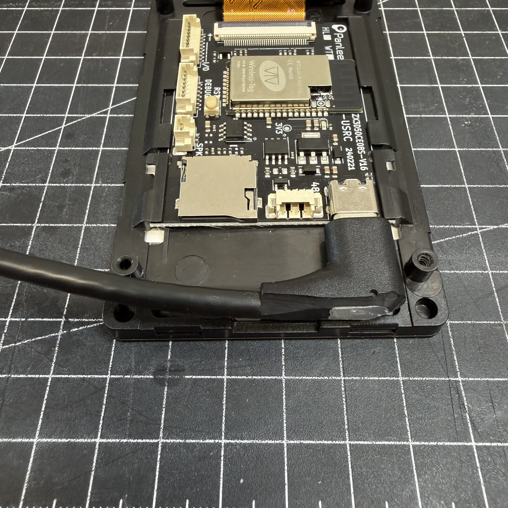
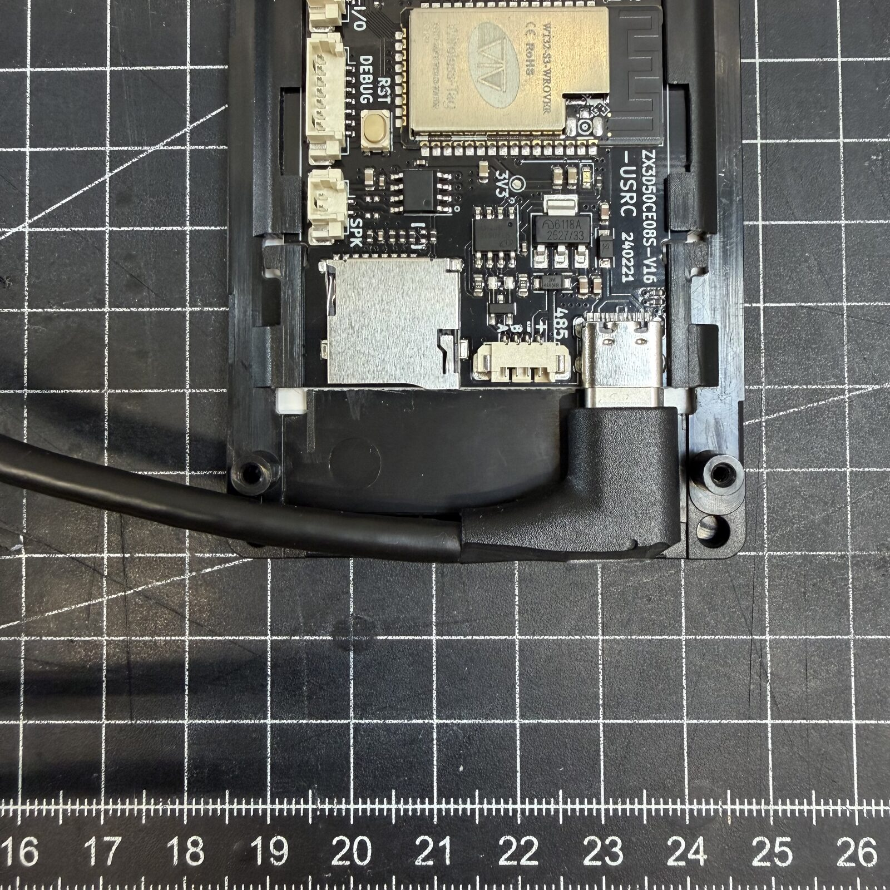
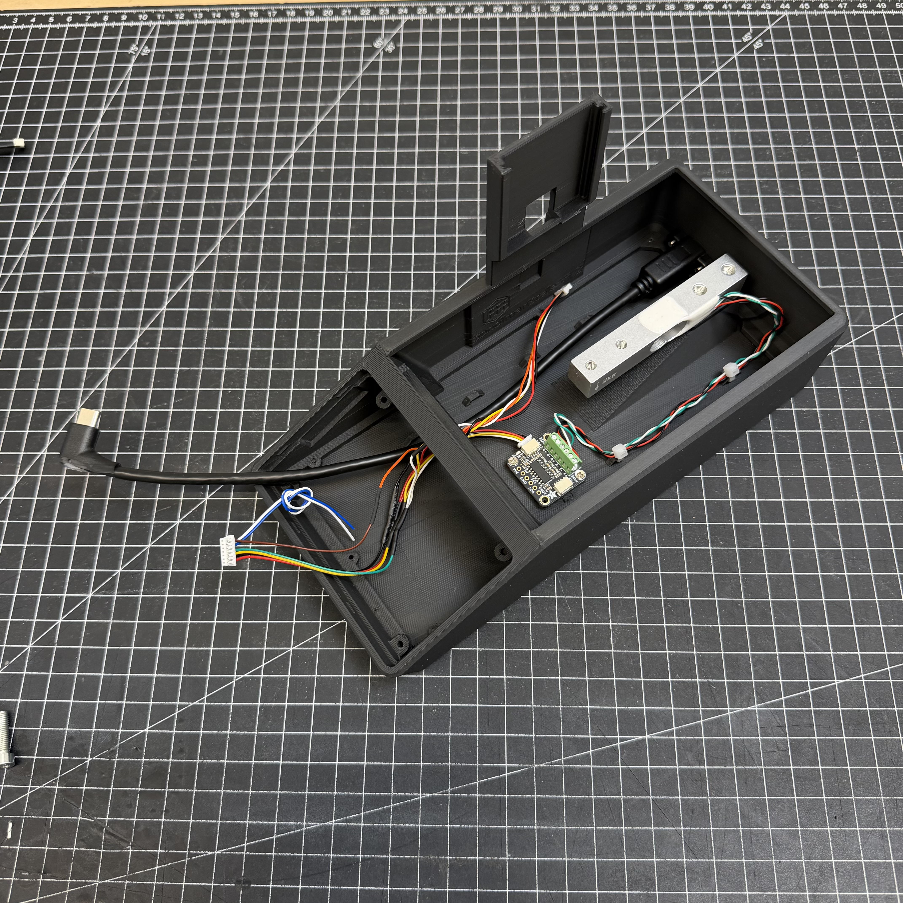
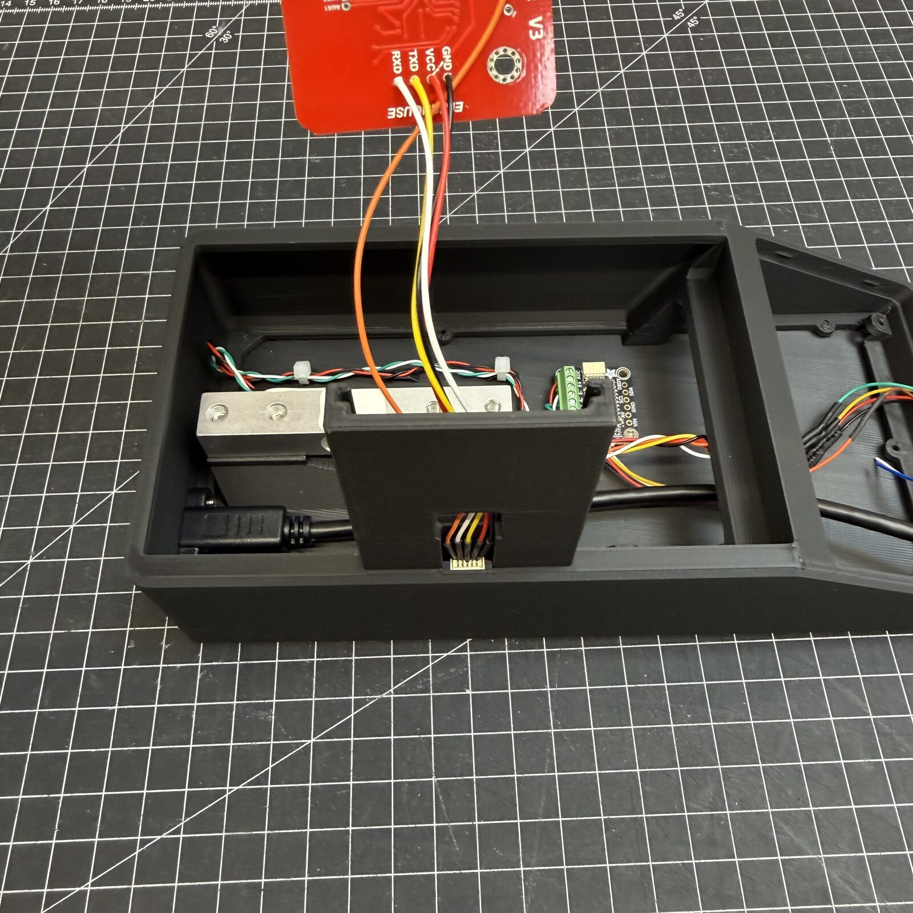
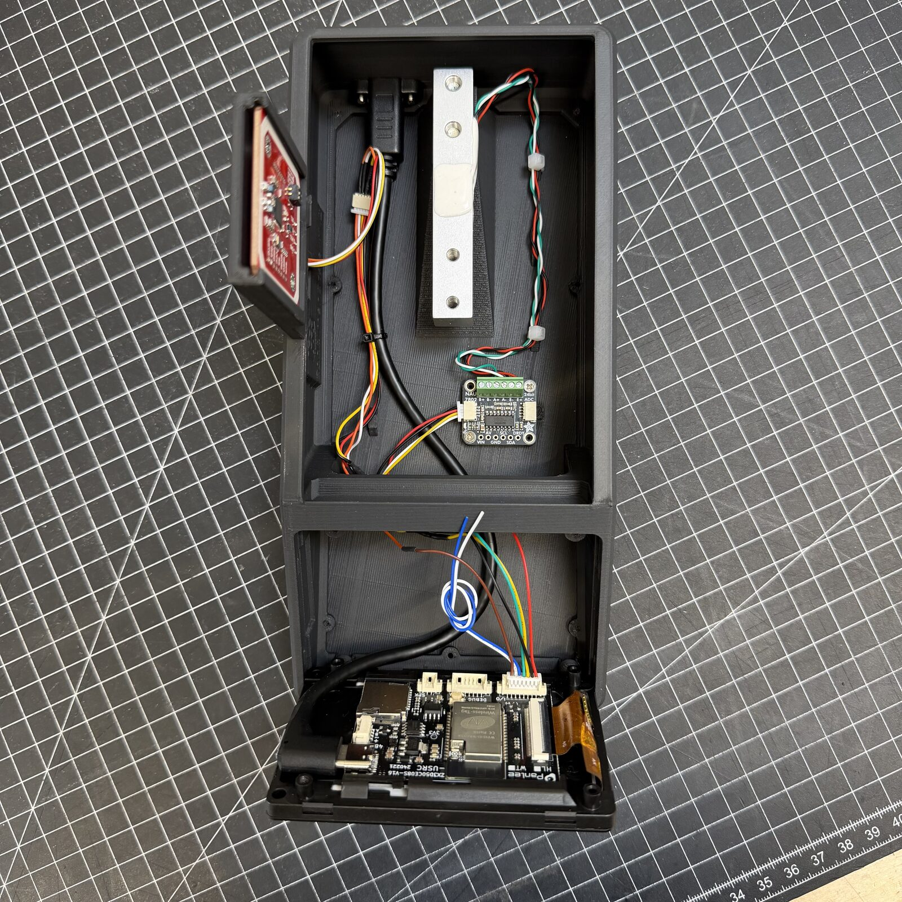

# Zusammenbau

Zum Nachschlagen: Schrauben und Fotos. Die Schritte stehen in der
[Bauanleitung](index.md).

---

## Schrauben

| Schraube | Anzahl | Wofür |
|---|---|---|
| M5, 20 bis 25 mm | 2 | Wägezelle hinten: **von unten durch den Boden** in die hinteren Löcher |
| M4, 12 bis 20 mm | 2 | Wägezelle vorne: **von oben durch die Spulenauflage** in die vorderen Löcher |
| M2,5x5 Blechschraube | 9 | Bodenplatte von unten ans Gehäuse |
| M2x4,4 Blechschraube | 2 bis 4 | NAU7802 an der Bodenplatte |

- Die vier Schrauben der Wägezelle tragen die Messung: fest anziehen, die Zelle
  darf kein Spiel haben. Der **Pfeil** auf der Zelle zeigt **nach unten**.
- Statt Blechschrauben gehen auch normale M2- oder M2,5-Schrauben.
- Die Löcher für die NAU7802 liegen je nach Hersteller der Platine etwas
  anders, deshalb passt es nicht immer genau.

---

## USB-C-Einbaubuchse kürzen

Das Steckergehäuse der Buchse steht über die Displaykante. Kürz es mit dem
Cuttermesser in kleinen Stücken, bis es bündig sitzt.

---

## Fotos

{ width="400" }

{ width="400" }

{ width="400" }

{ width="400" }

{ width="400" }
