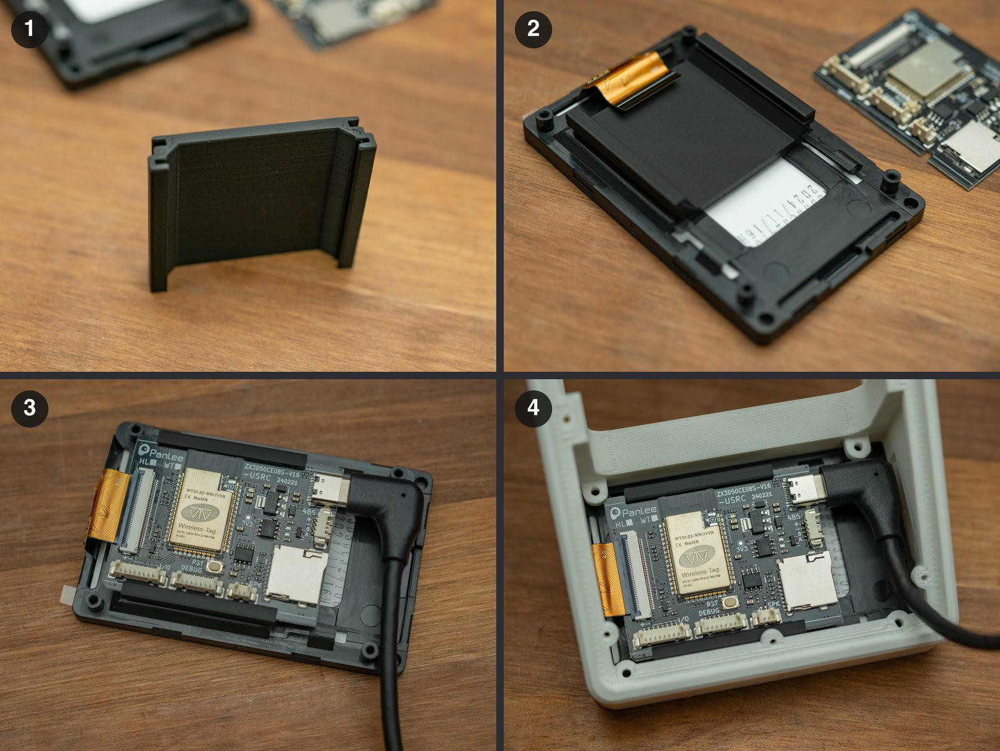
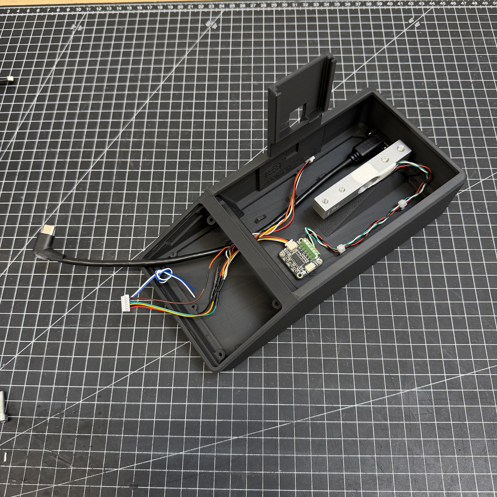
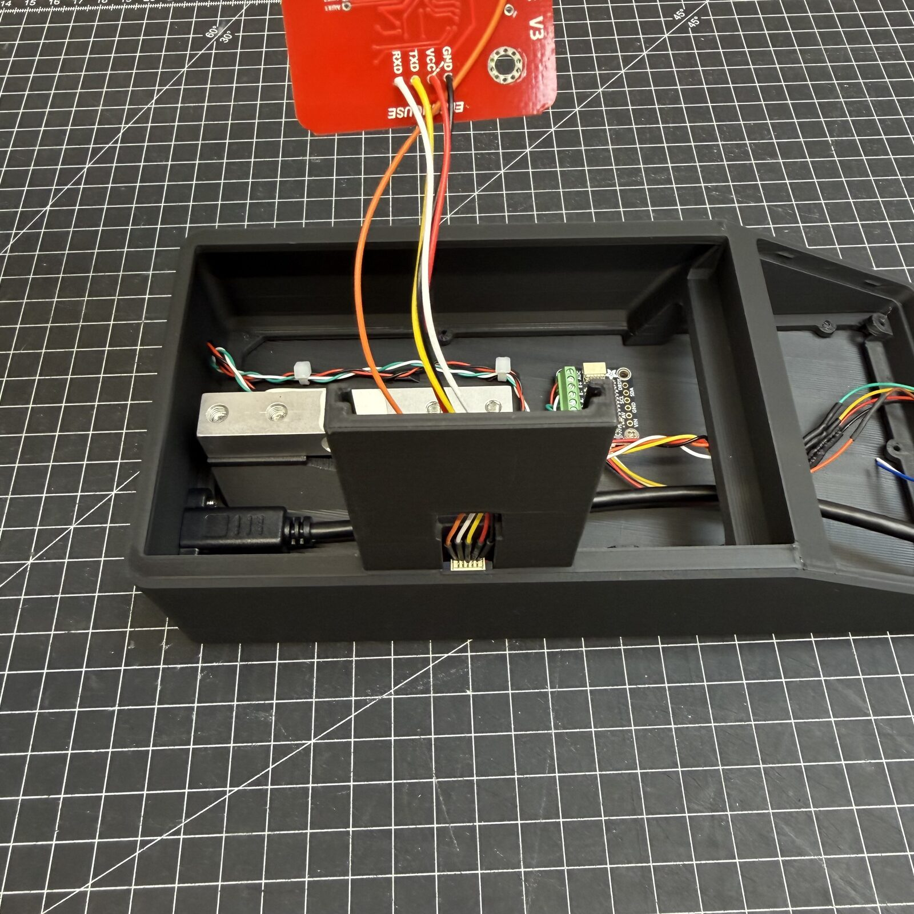
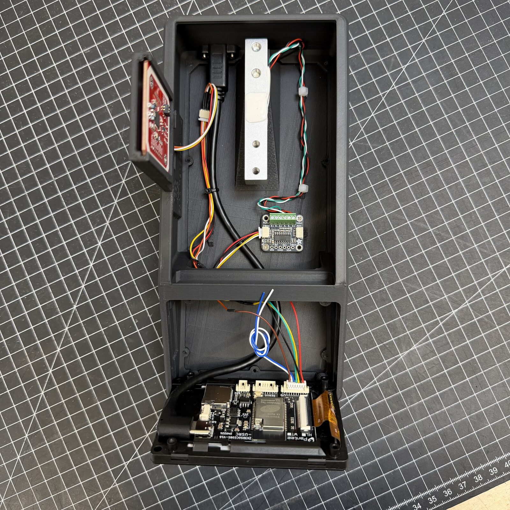

# Assembly

For reference: screws and photos. The steps are in the
[build guide](index.md).

---

## Screws

| Screw | Count | What for |
|---|---|---|
| M5, 20 to 25 mm | 2 | Load cell, back: **from below through the base** into the back holes |
| M4, 12 to 20 mm | 2 | Load cell, front: **from above through the spool platform** into the front holes |
| M2.5x5 self-tapping | 9 | Base plate to the case, from below |
| M2x4.4 self-tapping | 2 to 4 | NAU7802 on the base plate |

- The four load cell screws carry the measurement: tighten them firmly, the
  cell must not have any play. The **arrow** on the cell points **down**.
- Regular M2 or M2.5 screws work instead of self-tapping ones.
- The NAU7802 holes sit slightly differently depending on who made the board,
  so it does not always fit exactly.

---

## PCB Offset Mount for the USB-C socket

The printed bracket moves the board a little further in, so the angled plug of
the panel mount fits without cutting anything off. It is on the same print plate
as the base. The steps are in
[step 7 of the build guide](index.md#7-fit-the-usb-c-socket-close-the-case).

{ width="480" }

*Bracket and photos: thomasflummer. Tap to enlarge.*

---

## Photos

{ width="400" }

{ width="400" }

{ width="400" }
