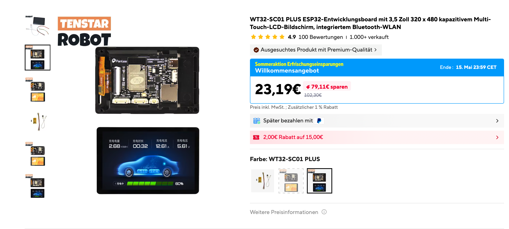
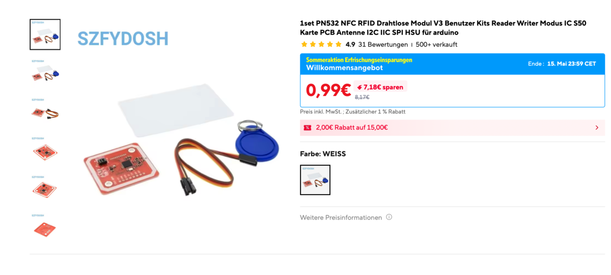
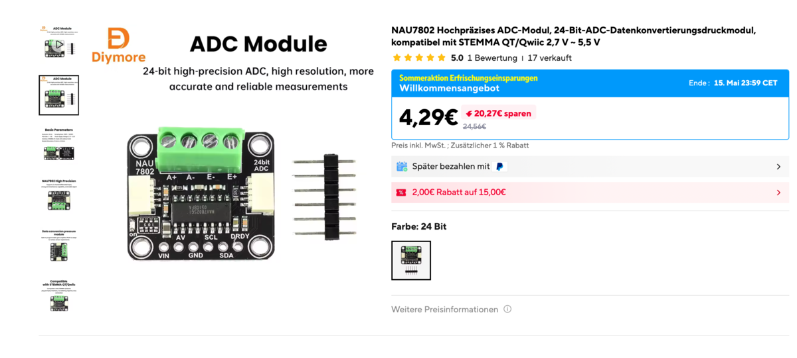
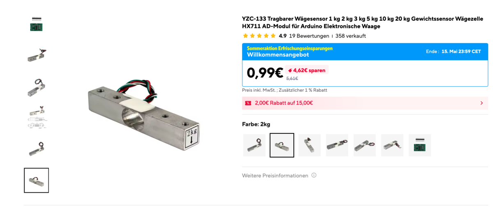
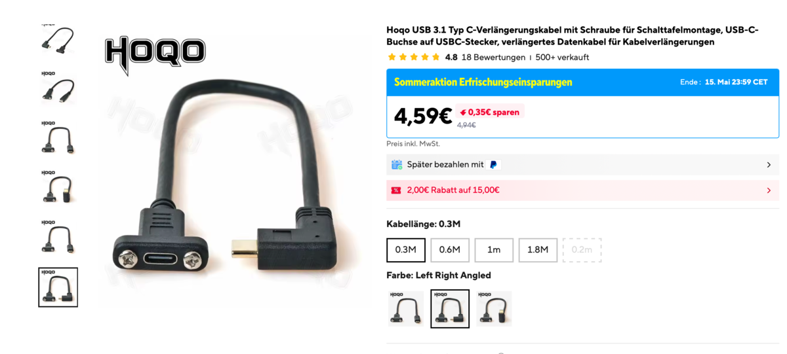
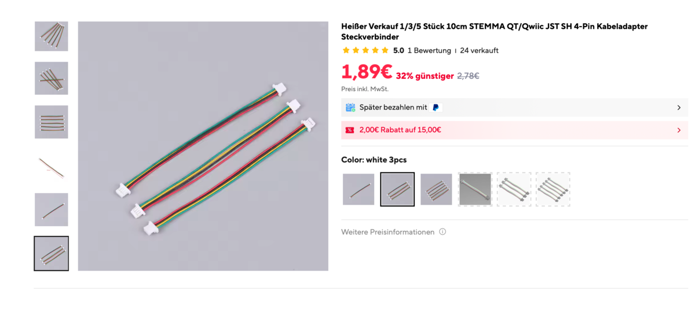
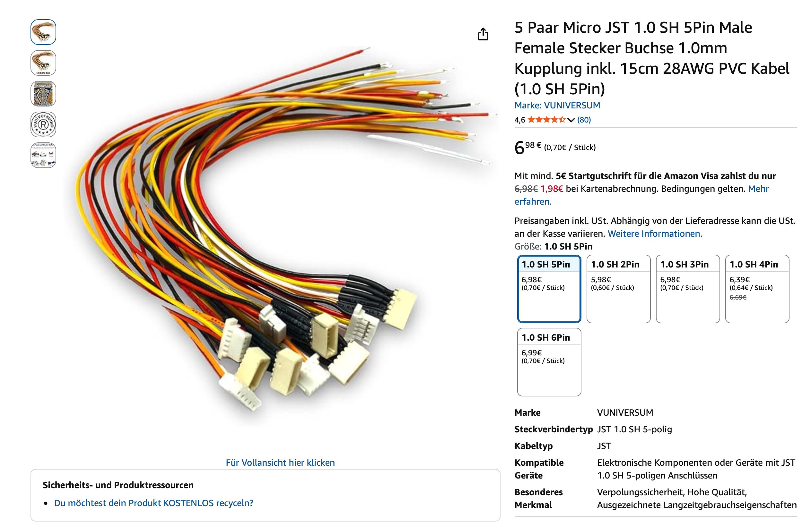

# Stückliste

Alles, was du für eine Waage brauchst. Wie die Teile zusammenkommen, steht in
der [Bauanleitung](index.md).

---

## Hauptbauteile

| Bild | Bauteil | Modell | Link |
|---|---|---|---|
|  | MCU + Display | WT32-SC01 Plus (ESP32-S3, 480x320, ST7796) | [AliExpress](https://de.aliexpress.com/item/1005006050379552.html) |
|  | NFC-Reader | PN532 | [AliExpress](https://a.aliexpress.com/_ExScN8M) |
|  | Waagen-ADC | NAU7802 (Adafruit empfohlen) | [AliExpress](https://de.aliexpress.com/item/1005011685825986.html) |
|  | Wägezelle | YZC-133 **2 kg** Balkenzelle (5 kg geht auch) | [AliExpress](https://a.aliexpress.com/_EuhhVF2) |
|  | USB-C-Einbaubuchse 90° | 30 cm, links/rechts gewinkelt, volles USB-C PD + Daten | [AliExpress](https://de.aliexpress.com/item/1005003488021890.html) |
|  | Verbindungskabel | STEMMA QT / JST | [AliExpress](https://de.aliexpress.com/item/1005011904682215.html) |
|  | Verbindungskabel (einfacherer Zusammenbau) | Micro JST 1.0 SH, 5-polig | [Amazon](https://amzn.eu/d/0aKJ4Va9) |

Die Pigtails und STEMMA-QT-Kabel brauchst du nur, wenn PN532 und NAU7802
später abziehbar sein sollen. Gelötet wird trotzdem, siehe
[Bauanleitung, Schritt 4](index.md#4-verkabeln). Die Buchse am
Display hat 8 Pins, das mitgelieferte Kabel nur 7. Pin 8 ist für eine spätere
Erweiterung frei; willst du dir das offenhalten, bestell ein 8-poliges Kabel
gleich mit.

Lieber alles in einem Warenkorb? Ein Nutzer aus der Community hat eine
AliExpress-Liste mit Teilen zusammengestellt, die ebenfalls gut funktionieren:
👉 [SpoolmanScale-Teileliste auf AliExpress](https://www.aliexpress.com/p/wish-manage/share.html?spm=a2g0o.cart.headerAcount.6.321738dayZTIa0&wishGroupId=800000022363334&smbPageCode=wishlist-amp&spreadId=E95BDFF0E1B4367408F1423D8C0ABF206981C084C10F93E3EE124B0AFA678D69)

Warum genau diese Teile und kein HX711 oder größeres Display:
[Hardware-Entscheidungen](../help/hardware.md).

---

## Weiteres Material

- Dünne Litze in 5 Farben (schwarz, rot, gelb, weiß, grün, je etwa 30 bis 40 cm)
- Schrauben, wofür welche ist steht unter [Zusammenbau](assembly.md#schrauben):

| Schraube | Anzahl |
|---|---|
| M5, 20 bis 25 mm | 2 |
| M4, 12 bis 20 mm | 2 |
| M2,5x5 Blechschraube | 9 |
| M2x4,4 Blechschraube ([Beispiel](https://a.aliexpress.com/_EyCD3rS)) | 2 bis 4 |

---

## Optional

| Teil | Wofür |
|---|---|
| **NTAG215**-NFC-Aufkleber | Tags, die die Waage beschreiben kann. NTAG213 reicht zum Lesen, ist zum Beschreiben aber zu klein, siehe [NFC-Tags](../use/tags.md#welche-tags-funktionieren) |
| **Phomemo M220**-Etikettendrucker | Spulenetiketten per Bluetooth drucken |
| Debug-Board ZXACC-ESPDB ([AliExpress](https://a.aliexpress.com/_Eu5Y0Ug)) | nicht nötig |

Auch NAU7802 und Wägezelle sind optional. Ohne sie arbeitet das Gerät als
Tag-Terminal, nur ohne Gewichte; dazu **Einstellungen → Spulen & Waage → Waage
vorhanden** ausschalten.

---

## Kosten

| Posten | Ungefähr |
|---|---|
| WT32-SC01 Plus | ca. 35 € |
| PN532, NAU7802, Wägezelle, Kabel | ca. 15 bis 25 € |
| Schrauben, Litze | ca. 5 € |
| Versand, Zoll und Gebühren | je nach Land |
| **Gesamt** | **ca. 60 bis 75 €** |

Das meiste kommt aus China, rechne mit **6 bis 15 Tagen** Lieferzeit.

Mit dem neuen EU-Zoll auf Pakete aus China kostet eine Bestellung bei
AliExpress aus der EU eher **100 Euro**. Es lohnt sich, die Teile einzeln zu
suchen: Elektronikhändler wie [Digi-Key](https://www.digikey.com) liefern ab
einem Mindestbestellwert versandkostenfrei, nach Europa ab 75 Euro. Je nach
Land gibt es einige Teile auch bei Amazon, eBay oder einem Händler vor Ort.

Das Gehäuse druckst du selbst, siehe [Gehäuse drucken](case.md).
