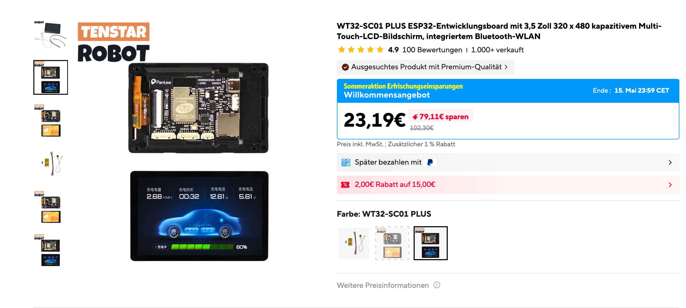
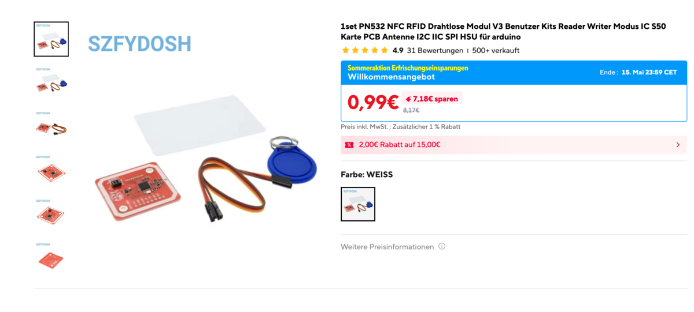
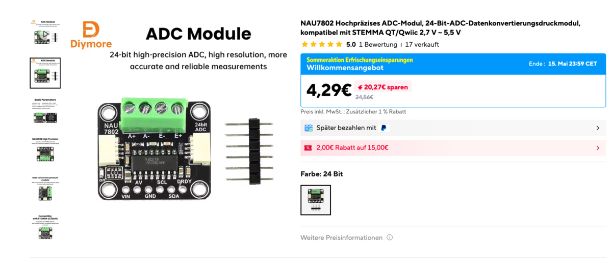
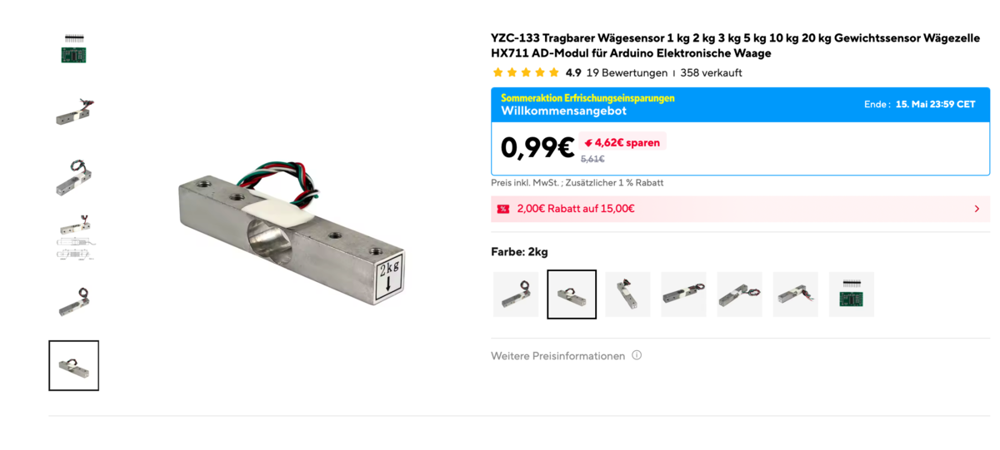
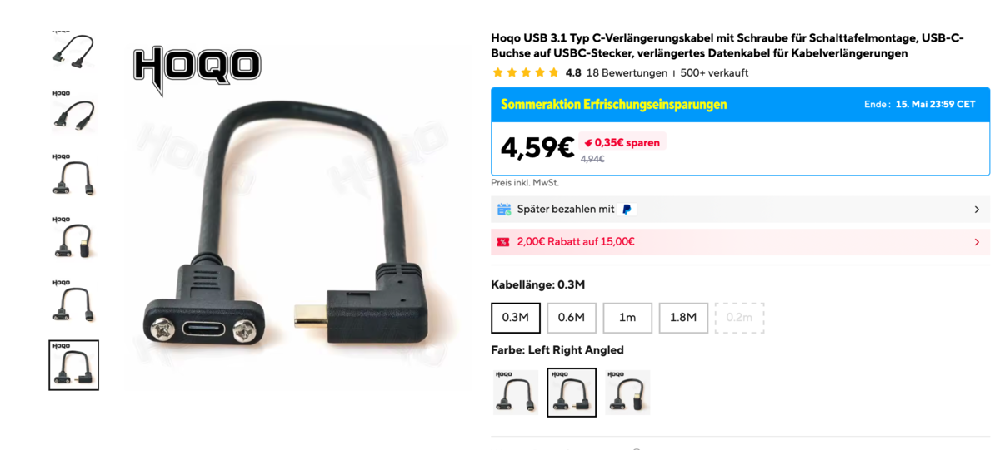
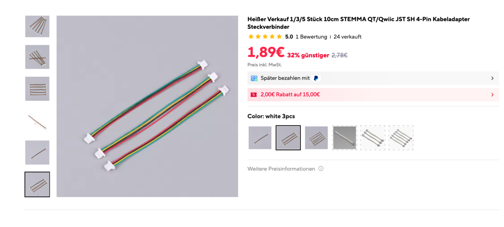
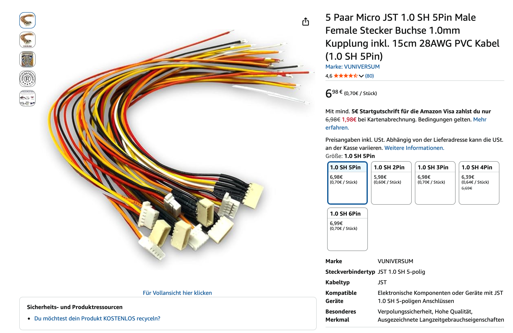

# Bill of materials

Everything you need for one scale. How the parts come together is in the
[build guide](index.md).

---

## Main components

| Image | Component | Model | Link |
|---|---|---|---|
|  | MCU + Display | WT32-SC01 Plus (ESP32-S3, 480×320, ST7796) | [AliExpress](https://de.aliexpress.com/item/1005006050379552.html) |
|  | NFC Reader | PN532 | [AliExpress](https://a.aliexpress.com/_ExScN8M) |
|  | Scale ADC | NAU7802 (Adafruit recommended) | [AliExpress](https://de.aliexpress.com/item/1005011685825986.html) |
|  | Load Cell | YZC-133 **2 kg** beam cell (5 kg works too) | [AliExpress](https://a.aliexpress.com/_EuhhVF2) |
|  | USB-C Panel Mount 90° | 30 cm, Left/Right Angled, full USB-C PD + data | [AliExpress](https://de.aliexpress.com/item/1005003488021890.html) |
|  | Connector Cables | STEMMA QT / JST cables | [AliExpress](https://de.aliexpress.com/item/1005011904682215.html) |
|  | Connector Cables (easier assembly) | Micro JST 1.0 SH 5-pin | [Amazon](https://amzn.eu/d/0aKJ4Va9) |

The pigtails and STEMMA QT cables are only needed if the PN532 and the NAU7802
should be removable later. You still solder, see
[build guide, step 4](index.md#4-wiring). The socket on the
display has 8 pins, the supplied cable only 7. Pin 8 is free for a later
extension; to keep that open, order an 8-pin cable along with the rest.

Prefer one cart? A community member put together an AliExpress list of parts
that also work well:
👉 [SpoolmanScale parts list on AliExpress](https://www.aliexpress.com/p/wish-manage/share.html?spm=a2g0o.cart.headerAcount.6.321738dayZTIa0&wishGroupId=800000022363334&smbPageCode=wishlist-amp&spreadId=E95BDFF0E1B4367408F1423D8C0ABF206981C084C10F93E3EE124B0AFA678D69)

Why exactly these parts and not a HX711 or a bigger display:
[Hardware choices](../help/hardware.md).

---

## Other material

- Thin wire in 5 colours (black, red, yellow, white, green, about 30 to 40 cm each)
- Screws, what each one is for is under [Assembly](assembly.md#screws):

| Screw | Count |
|---|---|
| M5, 20 to 25 mm | 2 |
| M4, 12 to 20 mm | 2 |
| M2.5x5 self-tapping | 9 |
| M2x4.4 self-tapping ([example](https://a.aliexpress.com/_EyCD3rS)) | 2 to 4 |

---

## Optional

| Part | What for |
|---|---|
| **NTAG215** NFC stickers | Tags the scale can write. NTAG213 works for reading, but is too small to write, see [NFC tags](../use/tags.md#which-tags-work) |
| **Phomemo M220** label printer | Printing spool labels over Bluetooth |
| Debug board ZXACC-ESPDB ([AliExpress](https://a.aliexpress.com/_Eu5Y0Ug)) | not needed |

The NAU7802 and the load cell are optional too. Without them the device works
as a tag terminal, just without weights; switch off **Settings → Spools &
scale → Scale fitted**.

---

## Cost

| Item | Roughly |
|---|---|
| WT32-SC01 Plus | about €35 |
| PN532, NAU7802, load cell, cables | about €15 to €25 |
| Screws, wire | about €5 |
| Shipping, customs and fees | depends on your country |
| **Total** | **about €60 to €75** |

Most of it ships from China, expect **6 to 15 days**.

If you order from the EU, the new EU duty on parcels from China brings an
AliExpress order to around **€100**. It pays to look for the parts one by
one: electronics distributors such as [Digi-Key](https://www.digikey.com) ship
for free above a minimum order, to Europe from €75. Depending on your country,
some parts are also on Amazon, eBay or at a local shop.

You print the case yourself, see [Printing the case](case.md).
