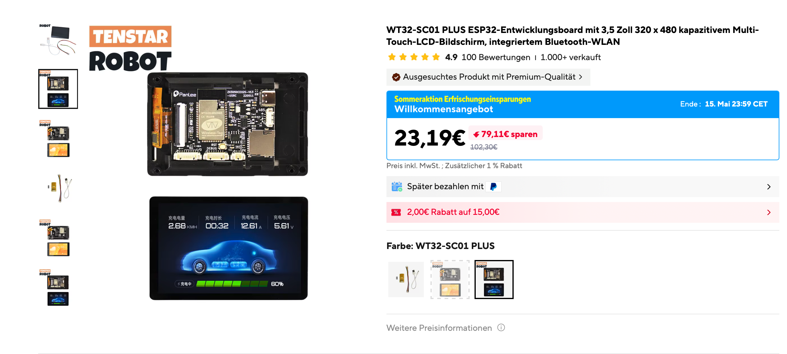
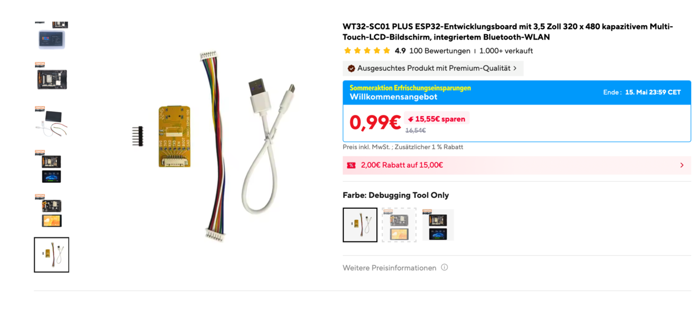
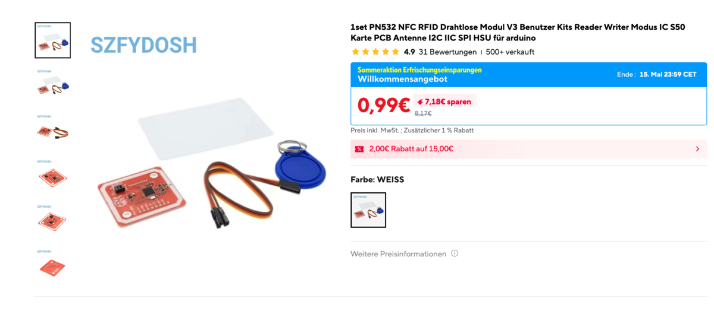
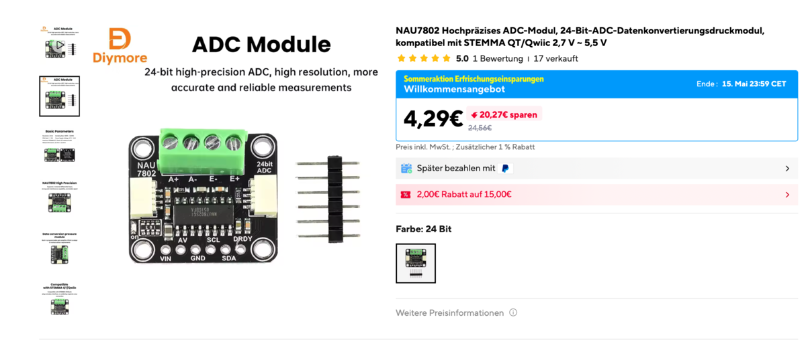
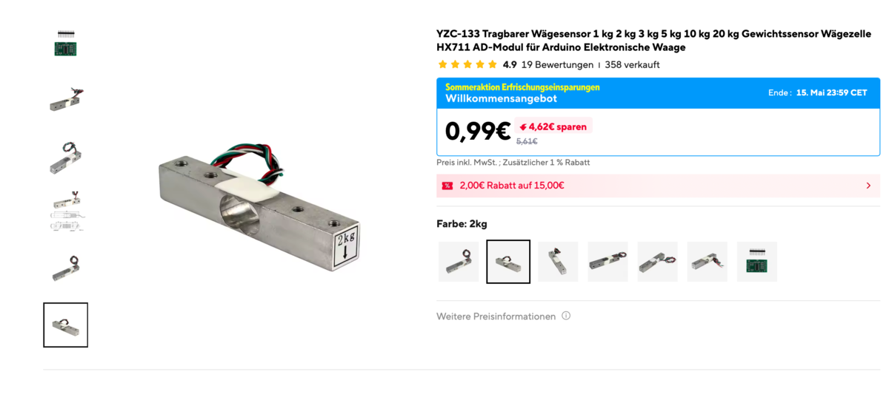
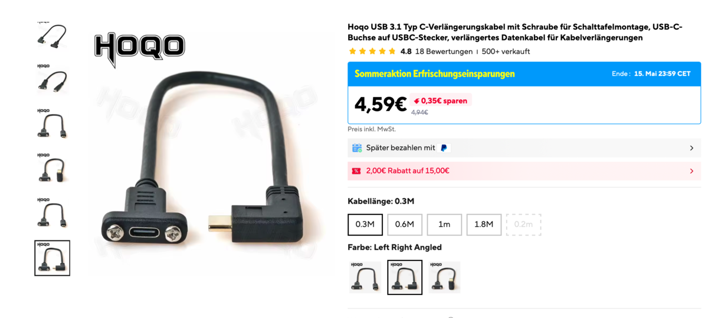
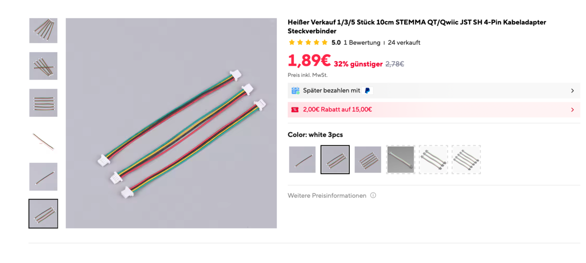
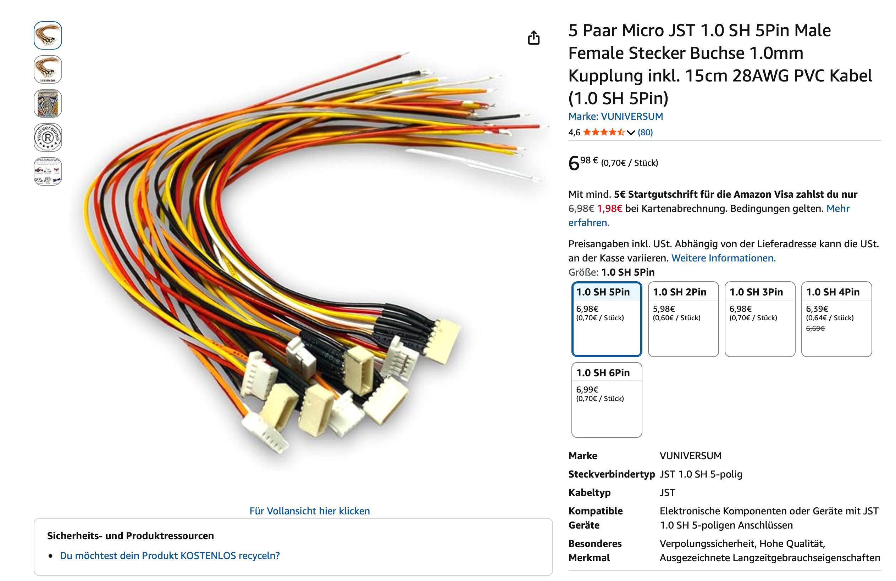

# Bill of Materials

!!! note "Something unclear or not fitting?"
    If something is unclear or doesn't fit your hardware batch, please report it on [Discord](https://discord.gg/K3KmKnrWhP) or [MakerWorld](https://makerworld.com/de/models/2713675-spoolmanscale#profileId-3005075).

---

## Core Components

| Image | Component | Model | Link |
|---|---|---|---|
|  | MCU + Display | WT32-SC01 Plus (ESP32-S3, 480×320, ST7796) | [AliExpress](https://de.aliexpress.com/item/1005006050379552.html) |
|  | Debug Board (not necessary) | ZXACC-ESPDB | [AliExpress](https://a.aliexpress.com/_Eu5Y0Ug) |
|  | NFC Reader | PN532 | [AliExpress](https://a.aliexpress.com/_ExScN8M) |
|  | Scale ADC | NAU7802 (Adafruit recommended) | [AliExpress](https://de.aliexpress.com/item/1005011685825986.html) |
|  | Load Cell | YZC-133 **2 kg** beam cell (5 kg works too) | [AliExpress](https://a.aliexpress.com/_EuhhVF2) |
|  | USB-C Panel Mount 90° | 30 cm, Left/Right Angled, full USB-C PD + data | [AliExpress](https://de.aliexpress.com/item/1005003488021890.html) |
|  | Connector Cables | STEMMA QT / JST cables | [AliExpress](https://de.aliexpress.com/item/1005011904682215.html) |
|  | Connector Cables (easier assembly) | Micro JST 1.0 SH 5-pin | [Amazon](https://amzn.eu/d/0aKJ4Va9) |

!!! info "How the parts connect: simpler than it looks"
    The WT32-SC01 Plus comes with a 7-pin cable with bare wire ends. Four wires
    carry the whole scale, and the PN532 and the NAU7802 take the same four.
    Go by the signal names, not the colours: cables from other shops use other
    colours.

    | Wire (WT32 pin) | Signal | PN532 | NAU7802 |
    |---|---|---|---|
    | Red (1) | 5 V | VCC | VIN |
    | Black (2) | GND | GND | GND |
    | Yellow (3) | SDA | SDA | SDA |
    | Green (4) | SCL | SCL | SCL |

    Split each wire into a Y, one end to each board. The PN532 gets one more
    wire, RSTPDN (brown, pin 7), which is optional.

    **Three ways to build it:**

    1. **Solder the Y** to the boards. Fastest and cheapest, no extra parts, but
       a faulty part is harder to swap.
    2. **Plug it together** with small connectors (the JST SH pigtails in the
       list). A bit more to buy, and parts swap easily.
    3. **Use a splitter board** from the community list below.

    **To keep options open:** the socket on the board has 8 pins, the supplied
    cable only 7. Pin 8 may be used later to wake the scale from the NFC reader.
    It does nothing today. If you want it, order an 8-pin cable or connector now.

    The step by step is on [Wiring](wiring.md). A video is coming soon.

!!! question "Why these parts and not others?"
    Why not an HX711, a bigger display or another NFC reader? The answers are on
    [Hardware choices](../help/hardware.md), for example
    [why the NAU7802](../help/hardware.md#adc) and
    [which boards we looked at](../help/hardware.md#boards).

Prefer everything in one cart? A community member put together an AliExpress
list with parts that work well too:
👉 [SpoolmanScale parts list on AliExpress](https://www.aliexpress.com/p/wish-manage/share.html?spm=a2g0o.cart.headerAcount.6.321738dayZTIa0&wishGroupId=800000022363334&smbPageCode=wishlist-amp&spreadId=E95BDFF0E1B4367408F1423D8C0ABF206981C084C10F93E3EE124B0AFA678D69)

!!! tip "2 kg vs 5 kg load cell"
    The 2 kg cell is recommended - most filament spools are well within range. A 5 kg cell works too but may be slightly less precise at low weights.

---

## Additional Materials

- Thin stranded wire in 5 different colors (black, red, yellow, white, green - ~30–40 cm each)
- 2× M5×25 socket head screws
- 2× M4×15 socket head screws
- 9× M2.5×5 self-tapping screws
- 2–4× M2×4.4 self-tapping screws ([example](https://a.aliexpress.com/_EyCD3rS))

Self-tapping screws are recommended, but standard machine screws (M2.5×5, M2×4) will likely work as well.

---

## Optional

| Item | What for |
|---|---|
| **NTAG215** NFC stickers | Tags the scale can write. NTAG213 works for reading, but is too small to write - see [NFC tags](../use/tags.md#which-tag-should-i-buy) |
| **Phomemo M220** label printer | Printing spool labels over Bluetooth |

!!! note "The load cell is optional too"
    Leave out the NAU7802 and the load cell, and switch off
    **Settings → Spools & scale → Scale fitted**. The device then works as a tag
    terminal: it reads, links and writes tags and sets locations, without
    weights.

---

## Enclosure

Download it from MakerWorld, printing notes on [Printing the case](case.md):

👉 [makerworld.com/@FormFollowsF](https://makerworld.com/de/models/2713675-spoolmanscale#profileId-3005075)

---

## Budget Estimate

| Item | Approx. cost |
|---|---|
| WT32-SC01 Plus | ~€35 |
| PN532, NAU7802, Load Cell, Cables | ~€15–25 |
| Screws, wire | ~€5 |
| **Total** | **~€50–60** |

!!! note "Shipping time"
    Most parts ship from China. Expect **6–15 days** delivery depending on your location and shipping option.

