# Bauanleitung

Acht Schritte vom Teilehaufen zur fertigen Waage. Jeder Schritt sagt in ein
paar Zeilen, was zu tun ist; die Einzelheiten stehen darunter zum Aufklappen.
Rechne mit etwa **2 Stunden** fürs Bauen und **20 Minuten** fürs Einrichten.

Du hast schon eine Waage? Dann willst du eher
[Firmware aktualisieren](../use/updating.md).

!!! note "Was du können musst"
    **Löten**: Der PN532 hat keinen Stecker, seine Adern werden angelötet.
    Programmieren musst du nicht, die Firmware ist fertig gebaut. Hängst du
    irgendwo fest, hilft die Community auf
    [Discord](https://discord.gg/K3KmKnrWhP).

---

## 1. Teile bestellen, Gehäuse drucken

Alles steht in der [Stückliste](bom.md): WT32-SC01 Plus, PN532, NAU7802,
2-kg-Wägezelle, USB-C-Einbaubuchse, Schrauben, Litze. Rechne mit **60 bis 75
Euro** und **6 bis 15 Tagen** Lieferzeit.

Seit den neuen EU-Regeln für Einfuhren kann eine Bestellung bei AliExpress
durch Zoll und Gebühren teurer werden als gedacht. Es lohnt sich, die Teile
einzeln zu suchen: Elektronikhändler wie
[Digi-Key](https://www.digikey.com) liefern ab einem Mindestbestellwert
versandkostenfrei, nach Europa ab 75 Euro. Je nach Land gibt es einige Teile
auch bei Amazon, eBay oder einem Händler vor Ort.

Das Gehäuse gibt es kostenlos auf
[MakerWorld](https://makerworld.com/de/models/2713675-spoolmanscale#profileId-3005075),
PLA oder PETG, etwa 4 bis 6 Stunden Druck. Hinweise unter
[Gehäuse drucken](case.md).

??? more "Ohne Wägezelle: nur NFC"
    NAU7802 und Wägezelle kannst du weglassen. Dann schaltest du später
    **Einstellungen → Spulen & Waage → Waage vorhanden** aus, und das Gerät
    arbeitet als Tag-Terminal: Es liest und beschreibt Tags und setzt
    Lagerorte, nur ohne Gewichte. Die Schritte 5 und 6 entfallen.

---

## 2. Zuerst flashen, nur zum Testen

Bevor du lötest: Steck das nackte Display per **USB-C-Datenkabel** an den
Rechner und spiel die Firmware über den
[Web-Flasher](https://niko11111.github.io/SpoolmanScale) auf (Chrome oder
Edge). Erscheint danach die Sprachauswahl, läuft das Board.

**Die Einrichtung jetzt noch nicht machen.** Einfach abstecken. Die richtige
Einrichtung kommt in Schritt 8, wenn die Waage fertig gebaut ist.

??? more "Der Web-Flasher findet das Gerät nicht"
    Viele USB-C-Kabel laden nur und übertragen keine Daten. Nimm ein anderes
    Kabel, am besten eines, mit dem du schon Daten übertragen hast.

---

## 3. PN532: Schalter auf I2C

Auf der Vorderseite des PN532 sitzt ein kleiner schwarzer Doppelschalter. Stell
ihn **vor dem Löten** auf I2C: **Schalter 1 nach oben (ON), Schalter 2 nach
unten**. Schieb jeden kräftig bis zum Anschlag. Manche Module sind anders
bedruckt; im Zweifel gilt die Tabelle neben dem Schalter, Spalte I2C:
SW1 = ON, SW2 = OFF.

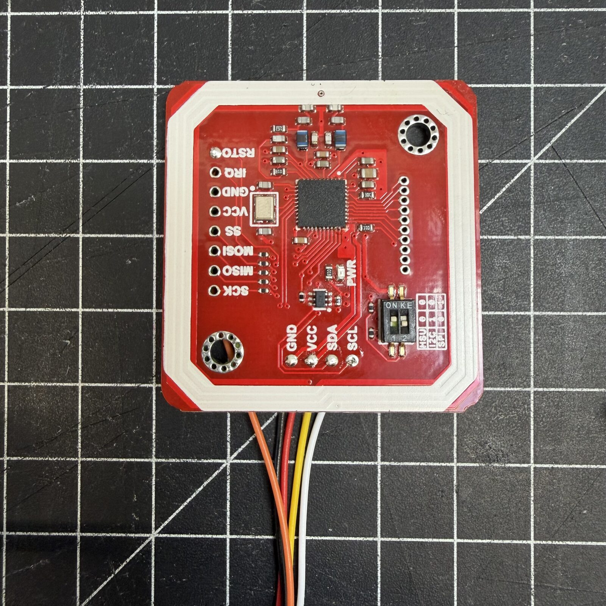{ width="400" }

Das ist der häufigste Grund, warum der NFC-Leser nicht geht: Später, im
Gehäuse, kommst du kaum noch an den Schalter.

---

## 4. Verkabeln

Zum Display gehört ein 7-poliges Kabel. Steck es **bündig links** in die
8-polige I/O-Buchse. Vier Adern teilen sich PN532 und NAU7802: Jede wird zu
einem **Y** aufgeteilt, ein Ende zu jeder Platine. Die fünfte geht nur an den
PN532.

| Kabel (Pin) | PN532 | NAU7802 |
|---|---|---|
| Rot (1), 5 V | VCC | VIN |
| Schwarz (2), GND | GND | GND |
| Gelb (3), SDA | SDA | SDA |
| Grün (4), SCL | SCL | SCL |
| Braun (7), Reset | RSTPDN | |

- Am PN532 **von hinten** löten. RSTPDN ist der letzte Pin der beschrifteten
  10-poligen Reihe, siehe „Fotos: Lötstellen am PN532“ weiter unten.
- PN532 **nicht** über den STEMMA-QT-Stecker der NAU7802 versorgen: Dort
  liegen nur 3,3 V an, der PN532 braucht 5 V.
- Pin 8 der Buchse ist heute unbelegt und für später reserviert. Willst du ihn
  dir offenhalten, bestell ein 8-poliges Kabel gleich mit.

Ein Video vom Aufbau kommt bald.

??? more "Gesamtplan zum Durchklicken (Cirkit Designer)"
    

      <iframe src="https://app.cirkitdesigner.com/project/680d6e91-778a-40bd-a907-62be13f7a97b?view=interactive_preview" style="position: absolute; top: 0; left: 0; width: 100%; height: 100%; border: none;"></iframe>
    

    
Interaktiv in <a href="https://app.cirkitdesigner.com/project/680d6e91-778a-40bd-a907-62be13f7a97b" target="_blank">Cirkit Designer</a>.

??? more "Fotos: Lötstellen am PN532 und die I/O-Buchse am Display"
    { width="400" }

    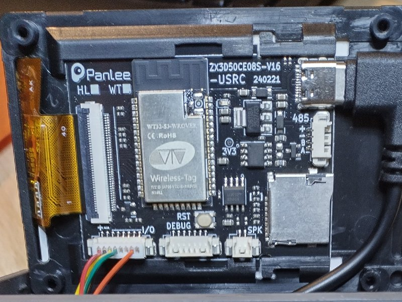{ width="400" }

    Reihenfolge im Gehäuse:

    1. NAU7802, Wägezelle und das Display-Kabel zuerst
    2. Die PN532-Adern lang lassen und von unten durch die Öffnung der
       PN532-Halterung führen
    3. Auf der Rückseite der PN532-Platine anlöten
    4. Den PN532 in seine Halterung schieben

??? more "Fotos: So haben andere verkabelt"
    Nutzer haben eigene Wege gefunden, das Y aufzuteilen. Vielleicht ist eine
    Idee für dich dabei. Am PN532 wird in jedem Fall gelötet, er hat keinen
    Stecker.

    **Y gelötet, PN532 am Stecker.** Die vier Adern sind zum Y verlötet und mit
    Schrumpfschlauch isoliert, der PN532 hängt an einem JST-Stecker und lässt
    sich abziehen.

    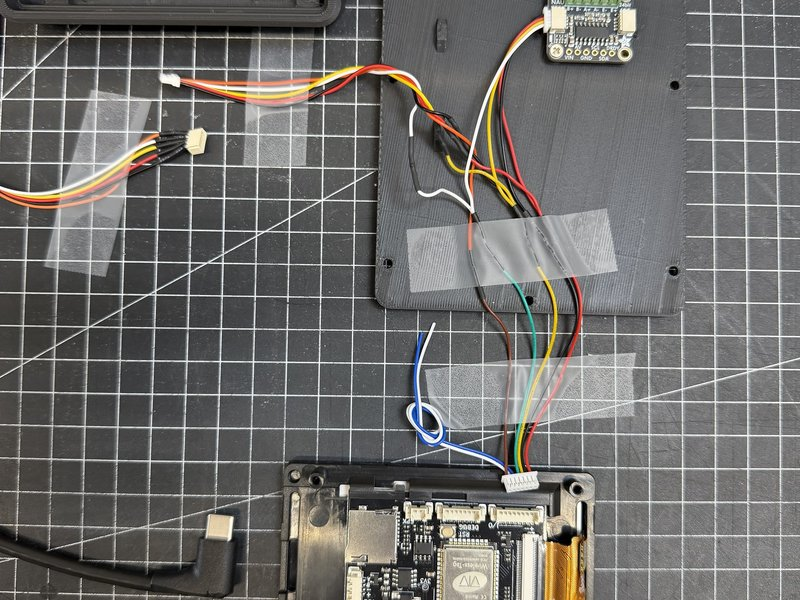{ width="400" }

    **Schraubklemmen statt Y-Lötstelle.** Manche NAU7802 haben auch auf der
    I2C-Seite eine Schraubklemme. Dann stecken die Adern vom Display und die
    zum PN532 einfach zu zweit in derselben Klemme.

    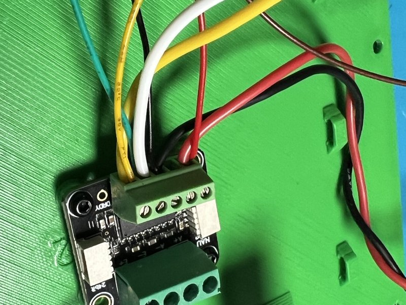{ width="400" }

    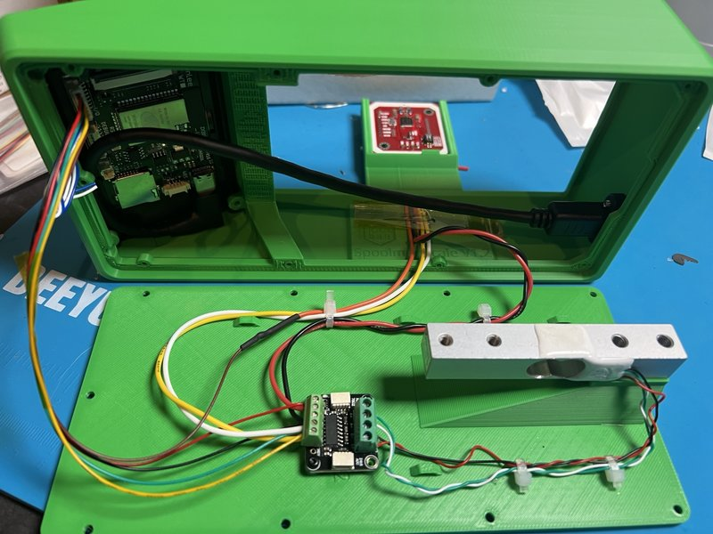{ width="400" }

    **Kleine Verteilerplatine.** Ein QWIIC-Verteiler (nicht in der Stückliste)
    ersetzt das Y: Display, PN532 und NAU7802 hängen mit JST-Kabeln daran.

    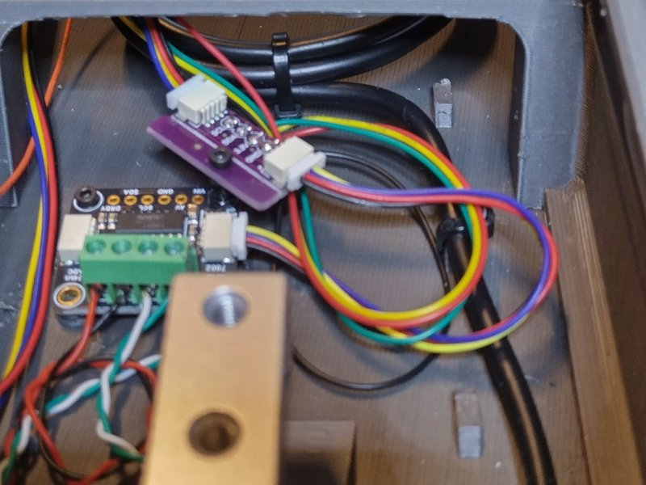{ width="400" }

    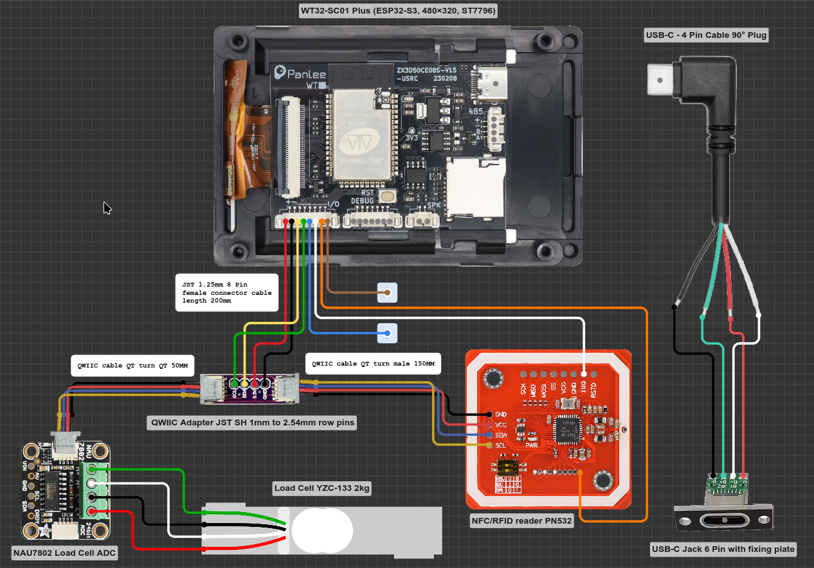

    *Zeichnung: mithkr. Antippen zum Vergrößern.* Anders als in der
    Bauanleitung:

    - **Weißer Draht an IRQ des PN532:** Lot ihn gern schon an den PN532,
      aber schließ ihn noch **nicht** ans Display an. An welchen Pin er später
      kommt, steht noch nicht fest.
    - **Farben:** ein 8-poliges Kabel, darin ist Reset (Pin 7) orange statt
      braun. Es zählt die Pinnummer.
    - **USB-C rechts:** eine andere Lösung als die Buchse aus der Stückliste.

??? more "Mit Steckern: Teile später tauschen"
    Ganz ohne Löten geht es nicht: Der PN532 hat keinen Stecker, ein 5-poliges
    JST-SH-Pigtail lötest du an ihn an, und die Adern vom Display verbindest du
    mit den Pigtails. Danach lassen sich PN532 und NAU7802 (über ihren
    STEMMA-QT-Stecker) abziehen und tauschen. Der Stecker passt durch die
    Öffnung der PN532-Halterung. Kabel aus anderen Shops haben eigene Farben
    und eine eigene Pinreihenfolge: Richte dich nach dem Signal, siehe
    [Pinreihenfolge der Stecker](wiring.md#connector-pin-order).

---

## 5. Wägezelle an die NAU7802

Die vier Adern der Wägezelle kommen in die Schraubklemmen der NAU7802:

| Ader | Klemme |
|---|---|
| Rot | E+ |
| Schwarz | E- |
| Weiß | A+ |
| Grün | A- |

**Verdrill die vier Adern** und leg sie ohne Zug. Ein Kabel, das an der Zelle
zieht oder lose herumliegt, lässt die Anzeige springen.

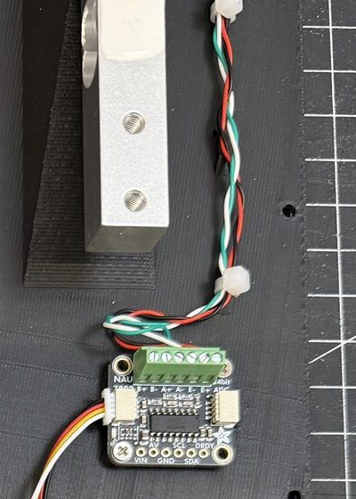{ width="300" }

Zeigt die Waage später negative Werte, tausch A+ und A-.

---

## 6. Wägezelle verschrauben

Vier Schrauben tragen die ganze Messung. Sitzen sie nicht fest, wiegt die
Waage falsch.

- **Pfeil** auf der Wägezelle zeigt **nach unten**.
- **Hinten, 2x M5 (20 bis 25 mm):** von **unten durch den Boden** in die
  hinteren Löcher der Wägezelle. Nicht von oben.
- **Vorne, 2x M4 (12 bis 20 mm, länger geht):** von **oben durch die
  Spulenauflage** in die vorderen Löcher der Wägezelle.

Beide Paare fest anziehen, die Zelle darf kein Spiel haben.

??? more "Die kleinen Schrauben"
    - **9x M2,5x5** (Blechschraube): halten die Bodenplatte von unten am
      Gehäuse. Normale M2- oder M2,5-Schrauben gehen auch.
    - **2 bis 4x M2x4,4**: halten die NAU7802 an der Bodenplatte. Die Löcher
      liegen je nach Hersteller der Platine etwas anders, deshalb passt es
      nicht immer genau.

---

## 7. USB-C-Buchse einbauen, Gehäuse schließen

Der gewinkelte Stecker der USB-C-Einbaubuchse braucht neben der Platine mehr
Platz, als das Display von Haus aus lässt. Ein gedruckter Adapter, der
**PCB Offset Mount**, rückt die Platine deshalb ein Stück nach innen, abschneiden musst du am Stecker
nichts mehr. Der Adapter liegt auf derselben Druckplatte wie der Boden.

Arbeite langsam, das Flachbandkabel und sein Stecker sind empfindlich:

1. I/O-Kabel von der Platine abziehen.
2. Verriegelung am Stecker des Flachbandkabels öffnen und das Kabel
   herausziehen, ohne daran zu reißen.
3. Platine vorsichtig aus ihrer Kunststoffhalterung am Display lösen.
4. Adapter in die Halterung einsetzen (Foto 1 und 2).
5. Platine in den Adapter setzen, Flachbandkabel wieder einstecken und
   verriegeln, I/O-Kabel wieder aufstecken (Foto 3).
6. USB-C-Buchse einstecken und das Display ins Gehäuse drücken (Foto 4). Es
   hält ohne Schrauben.

Bleibt das Display später dunkel, prüf zuerst das Flachbandkabel.

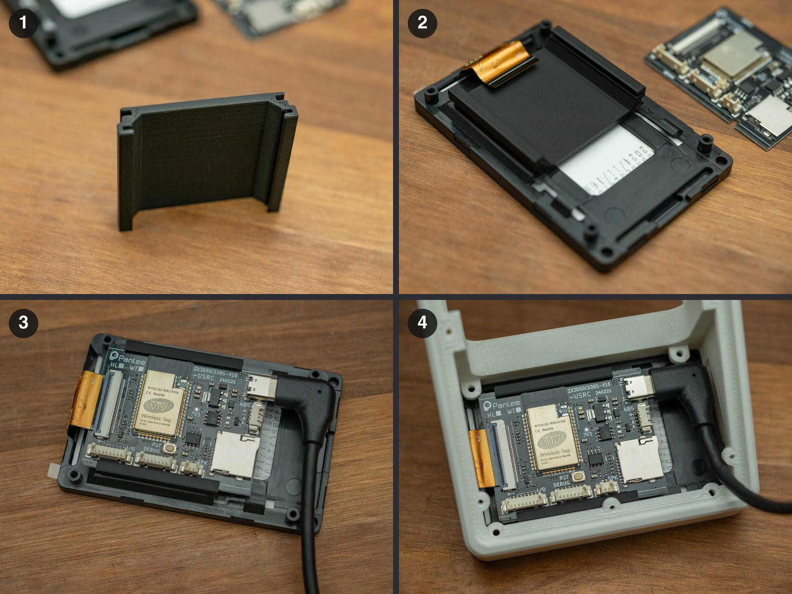{ width="480" }

*Adapter und Fotos: thomasflummer. Antippen zum Vergrößern.*

**Bevor du zumachst, prüf diese drei Dinge.** Fast jede Supportanfrage lief
auf einen davon hinaus:

- PN532-Schalter auf **SW1 = ON, SW2 = OFF**, beide bis zum Anschlag
- Wägezelle mit allen **vier Schrauben fest**, Kabel **verdrillt und ohne
  Zug**
- Die **Spulenauflage berührt nirgends den Rand** und drückt nicht auf die
  Zelle. Achte auf den **weißen Kleber**, der die feinen Drähte auf der
  Wägezelle abdeckt: Steht er über die Kante, kann die Auflage darauf drücken
  und die Zelle verspannen.

??? more "Fotos vom Zusammenbau"
    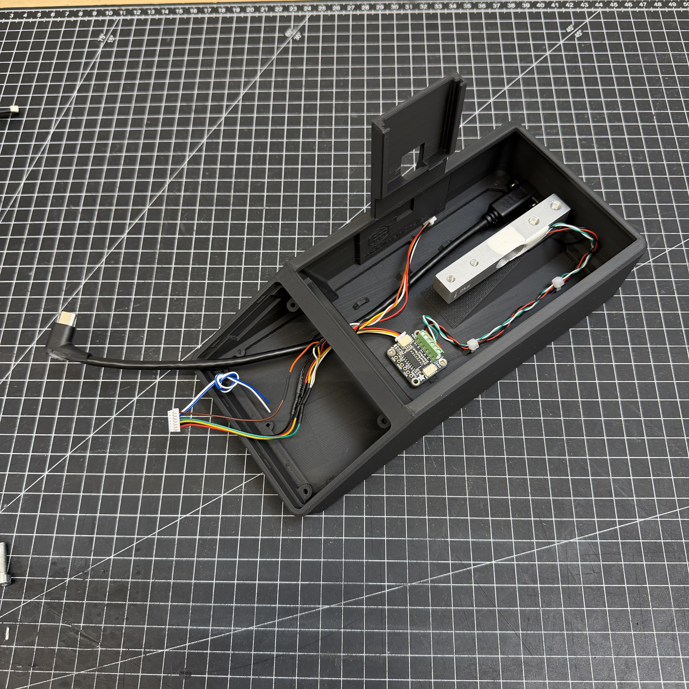
    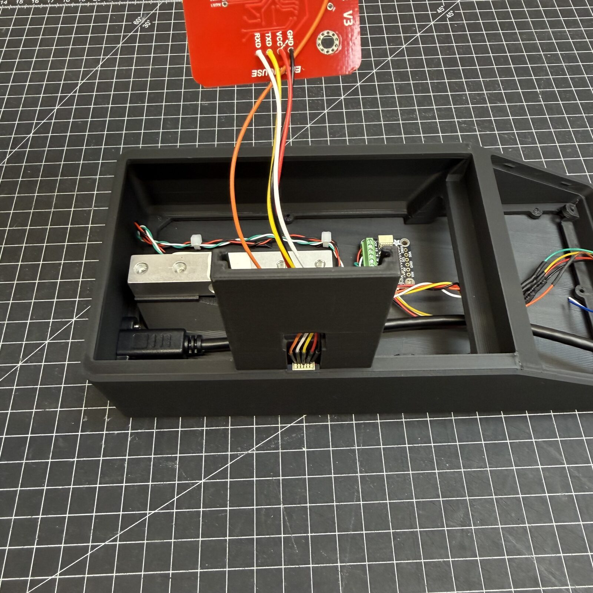
    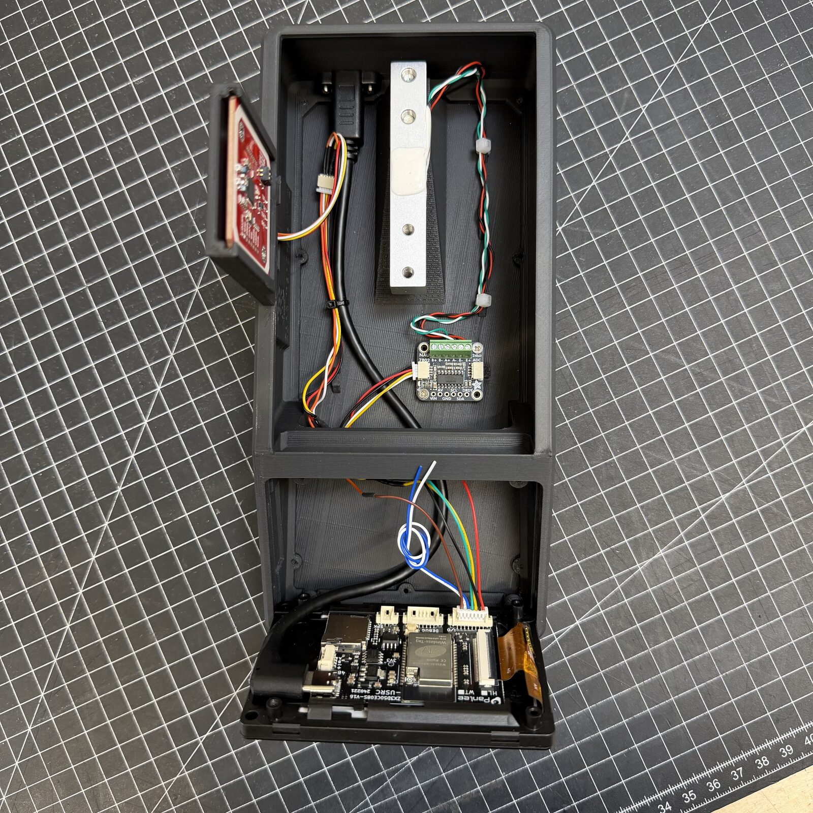

---

## 8. Einschalten, einrichten, kalibrieren

Jetzt wird die Waage eingerichtet: Strom dran und die Einrichtung
durchgehen, Sprache, WLAN, Server. Alles Schritt für Schritt unter
[Flashen & Ersteinrichtung](../use/index.md). Am Ende fragt die Waage nach der
Kalibrierung: **Jetzt kalibrieren** antippen.

!!! danger "Ohne Kalibrierung stimmt kein Gewicht"
    Eine neue Waage weiß nicht, wie schwer etwas ist, bis du es ihr einmal
    zeigst. Das dauert eine Minute:

    1. **Einstellungen → Spulen & Waage → Kalibrierung**
    2. Waage leer, **TARE** antippen
    3. Etwas mit bekanntem Gewicht auflegen, ideal etwa 1000 g, zum Beispiel
       eine volle Spule, die du auf der Küchenwaage nachgewogen hast
    4. Das Gewicht eintippen, **Berechnen** antippen

    Mehr dazu unter [Wiegen & Kalibrieren](../use/weighing.md).

Danach: [Deine ersten Spulen](../use/first-spools.md).

??? more "Etwas geht nicht?"
    Die Waage prüft sich bei jedem Start selbst und sagt in der Statusleiste,
    was fehlt. Was jede Meldung bedeutet, steht unter
    [Was die Waage dir sagt](../help/index.md). Passt bei dir ein Teil nicht,
    sag es auf [Discord](https://discord.gg/K3KmKnrWhP) oder
    [MakerWorld](https://makerworld.com/de/models/2713675-spoolmanscale#profileId-3005075).
