# Build guide

Eight steps from a pile of parts to a working scale. Each step tells you in a
few lines what to do; the details sit underneath, ready to expand. Plan on
about **2 hours** to build and **20 minutes** to set up.

Already have a scale? You probably want
[Updating the firmware](../use/updating.md).

!!! note "What you need to be able to do"
    **Solder**: the PN532 has no connector, its wires are soldered on. No
    programming needed, the firmware comes ready-built. Stuck somewhere? The
    community helps on [Discord](https://discord.gg/K3KmKnrWhP).

---

## 1. Order the parts, print the case

Everything is in the [bill of materials](bom.md): WT32-SC01 Plus, PN532,
NAU7802, 2 kg load cell, USB-C panel mount, screws, wire. Plan on **€60 to
€75** and **6 to 15 days** of shipping.

If you order from the EU, the new import rules can make an AliExpress order
more expensive than expected through customs and fees. It pays to look for the
parts one by one: electronics distributors such as
[Digi-Key](https://www.digikey.com) ship for free above a minimum order, to
Europe from €75. Depending on your country, some parts are also on Amazon, eBay
or at a local shop.

The case is free on
[MakerWorld](https://makerworld.com/de/models/2713675-spoolmanscale#profileId-3005075),
PLA or PETG, about 4 to 6 hours of printing. Notes under
[Printing the case](case.md).

??? more "Without a load cell: NFC only"
    You can leave out the NAU7802 and the load cell. Later you switch off
    **Settings → Spools & scale → Scale fitted**, and the device works as a tag
    terminal: it reads and writes tags and sets locations, just without
    weights. Steps 5 and 6 drop out.

---

## 2. Flash first, just to test

Before you solder: plug the bare display into your computer with a **USB-C
data cable** and install the firmware with the
[web flasher](https://niko11111.github.io/SpoolmanScale) (Chrome or Edge). If
the language picker shows up afterwards, the board works.

**Do not run the setup yet.** Just unplug it. The real setup comes in step 8,
once the scale is built.

??? more "The web flasher does not find the device"
    Many USB-C cables only charge and carry no data. Use another cable,
    ideally one you have already moved data with.

---

## 3. PN532: switches to I2C

On the front of the PN532 sits a small black double switch. Set it to I2C
**before you solder**: **switch 1 up (ON), switch 2 down**. Push each one
firmly all the way. Some modules are printed differently; when in doubt, the
table next to the switch decides, column I2C: SW1 = ON, SW2 = OFF.

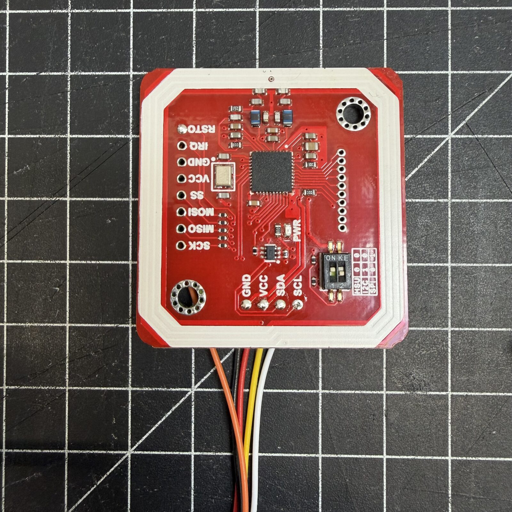{ width="400" }

This is the most common reason the NFC reader does not work: later, inside
the case, you can hardly reach the switch.

---

## 4. Wiring

The display comes with a 7-pin cable. Plug it **flush to the left** into the
8-pin I/O socket. Four wires are shared by the PN532 and the NAU7802: split
each one into a **Y**, one end to each board. The fifth goes to the PN532 only.

| Cable (pin) | PN532 | NAU7802 |
|---|---|---|
| Red (1), 5 V | VCC | VIN |
| Black (2), GND | GND | GND |
| Yellow (3), SDA | SDA | SDA |
| Green (4), SCL | SCL | SCL |
| Brown (7), reset | RSTPDN | |

- Solder the PN532 **from the back**. RSTPDN is the last pin of the labelled
  10-pin row, see "Photos: solder joints on the PN532" further down.
- Do **not** power the PN532 through the NAU7802's STEMMA QT connector: it
  only carries 3.3 V, the PN532 needs 5 V.
- Pin 8 of the socket is unused today and reserved for later. To keep that
  option open, order an 8-pin cable along with the rest.

A build video is coming soon.

??? more "Overall plan to click through (Cirkit Designer)"
    

      <iframe src="https://app.cirkitdesigner.com/project/680d6e91-778a-40bd-a907-62be13f7a97b?view=interactive_preview" style="position: absolute; top: 0; left: 0; width: 100%; height: 100%; border: none;"></iframe>
    

    
Interactive in <a href="https://app.cirkitdesigner.com/project/680d6e91-778a-40bd-a907-62be13f7a97b" target="_blank">Cirkit Designer</a>.

??? more "Photos: solder joints on the PN532 and the I/O socket on the display"
    { width="400" }

    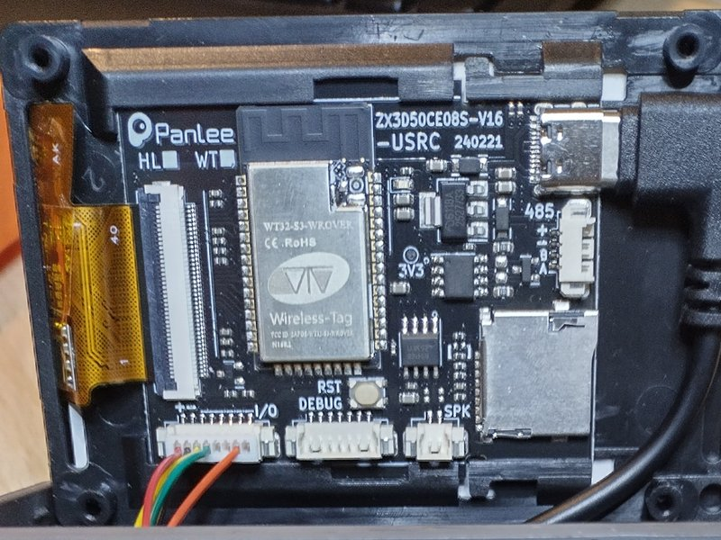{ width="400" }

    Order inside the case:

    1. NAU7802, load cell and the display cable first
    2. Leave the PN532 wires long and feed them up through the opening of the
       PN532 mount from below
    3. Solder them to the back of the PN532 board
    4. Slide the PN532 into its mount

??? more "Photos: how others wired it"
    Builders have found their own ways to split the Y. Maybe one of them suits
    you. The PN532 gets soldered either way, it has no connector.

    **Y soldered, PN532 on a plug.** The four wires are soldered into a Y and
    insulated with heat shrink; the PN532 hangs on a JST plug and can be
    pulled off.

    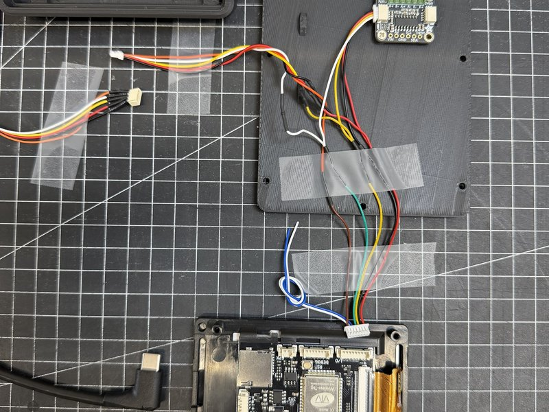{ width="400" }

    **Screw terminals instead of a soldered Y.** Some NAU7802 boards have a screw
    terminal on the I2C side as well. Then the wires from the display and those
    to the PN532 simply share the same terminal, two to a slot.

    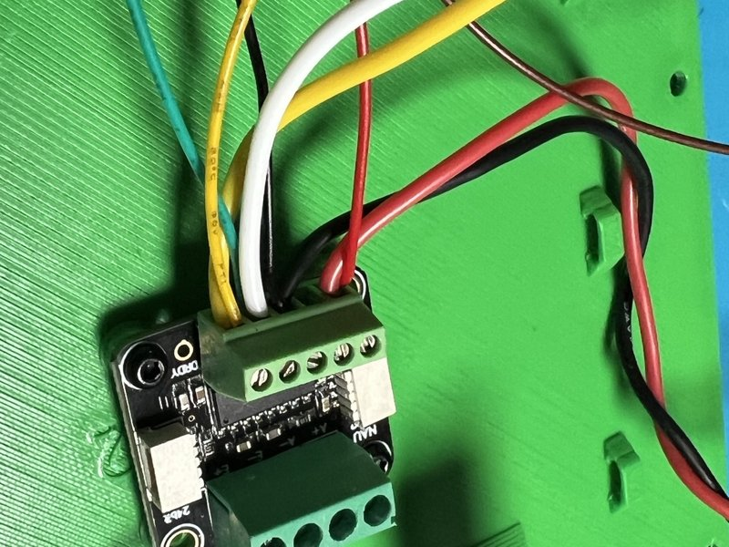{ width="400" }

    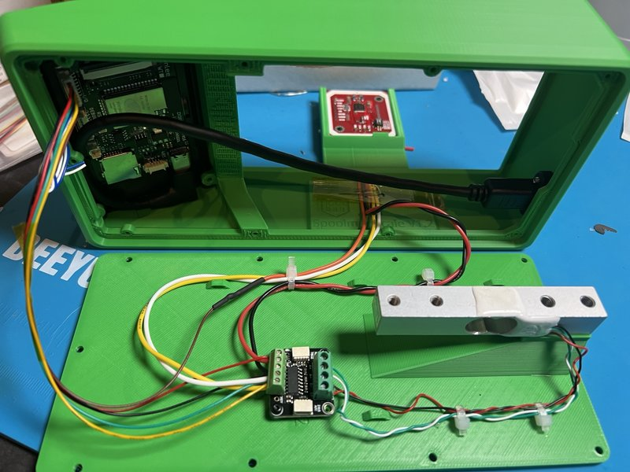{ width="400" }

    **A small splitter board.** A QWIIC splitter (not in the bill of
    materials) replaces the Y: display, PN532 and NAU7802 hang off it on JST
    cables.

    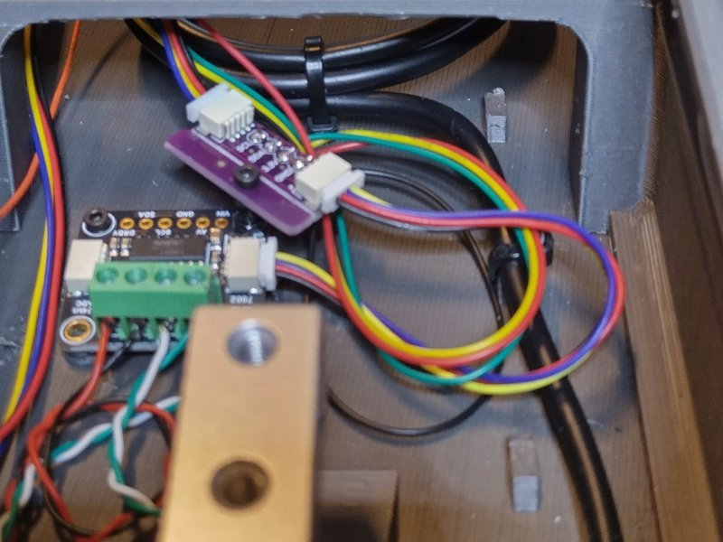{ width="400" }

    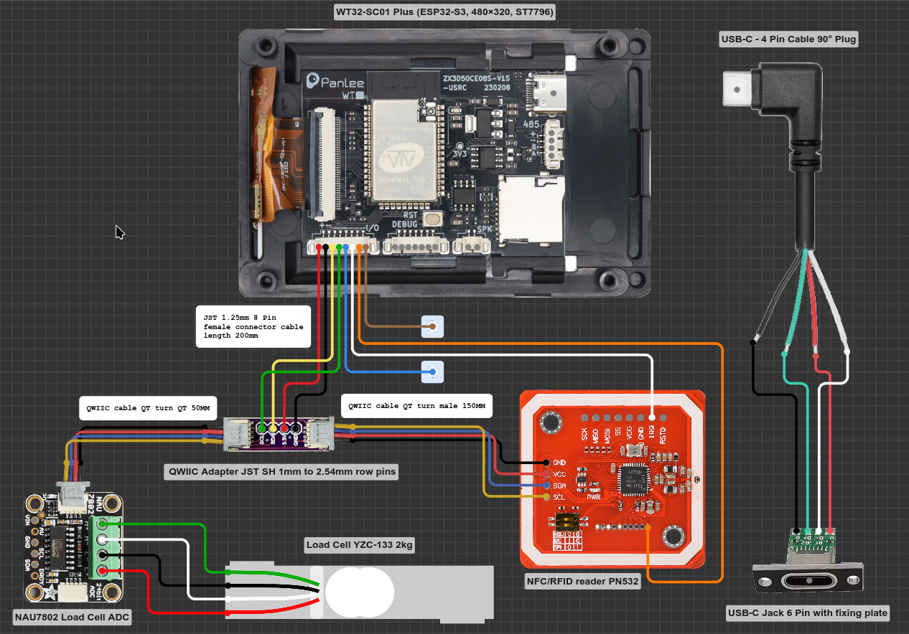

    *Drawing: mithkr. Tap to enlarge.* Different from the build guide:

    - **White wire to IRQ on the PN532:** feel free to solder it to the PN532
      already, but do **not** connect it to the display yet. Which pin it will
      go to is not settled.
    - **Colours:** an 8-pin cable, in which reset (pin 7) is orange instead of
      brown. The pin number is what counts.
    - **USB-C on the right:** a different solution from the panel mount in
      the bill of materials.

??? more "With plugs: swap parts later"
    It does not work entirely without soldering: the PN532 has no connector,
    so you solder a 5-pin JST SH pigtail onto it and join the wires from the
    display to the pigtails. After that, the PN532 and the NAU7802 (through its
    STEMMA QT connector) can be unplugged and swapped. The plug fits through
    the opening of the PN532 mount. Cables from other shops have their own colours and pin
    order: go by the signal, see
    [Connector pin order](wiring.md#connector-pin-order).

---

## 5. Load cell to the NAU7802

The four wires of the load cell go into the NAU7802's screw terminals:

| Wire | Terminal |
|---|---|
| Red | E+ |
| Black | E- |
| White | A+ |
| Green | A- |

**Twist the four wires** and lay them without strain. A cable that pulls on
the cell or lies loose makes the reading jump.

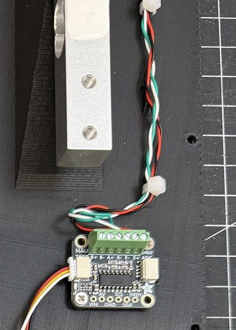{ width="300" }

If the scale shows negative values later, swap A+ and A-.

---

## 6. Screw down the load cell

Four screws carry the whole measurement. If they are not tight, the scale
weighs wrong.

- The **arrow** on the load cell points **down**.
- **Back, 2x M5 (20 to 25 mm):** from **below through the base** into the
  back holes of the load cell. Not from above.
- **Front, 2x M4 (12 to 20 mm, longer works):** from **above through the
  spool platform** into the front holes of the load cell.

Tighten both pairs firmly; the cell must not have any play.

??? more "The small screws"
    - **9x M2.5x5** (self-tapping): hold the base plate to the case from below.
      Regular M2 or M2.5 screws work too.
    - **2 to 4x M2x4.4**: hold the NAU7802 on the base plate. The holes sit
      slightly differently depending on who made the board, so it does not
      always fit exactly.

---

## 7. Fit the USB-C socket, close the case

The USB-C panel mount has to be trimmed: cut the plug housing back in small
pieces with a utility knife until it no longer sticks out past the edge of the
display. Then press the display into the case. It holds without screws.

**Before you close it, check these three things.** Almost every support
request came down to one of them:

- PN532 switches on **SW1 = ON, SW2 = OFF**, both all the way
- Load cell held by all **four screws, tight**, cable **twisted and without
  strain**
- The **spool platform touches the rim nowhere** and does not press on the
  cell, for example because the white glue underneath is too thick

??? more "Photos of the assembly"
    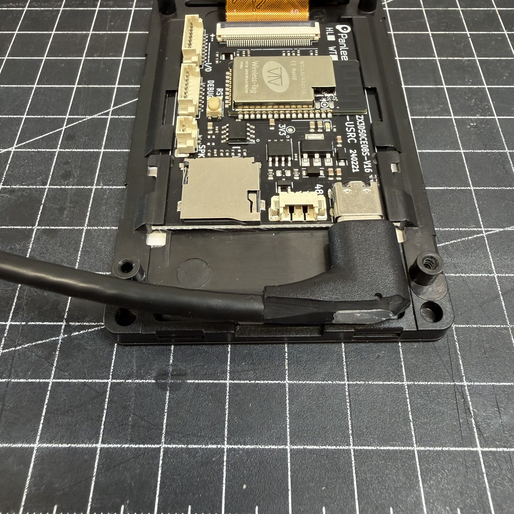
    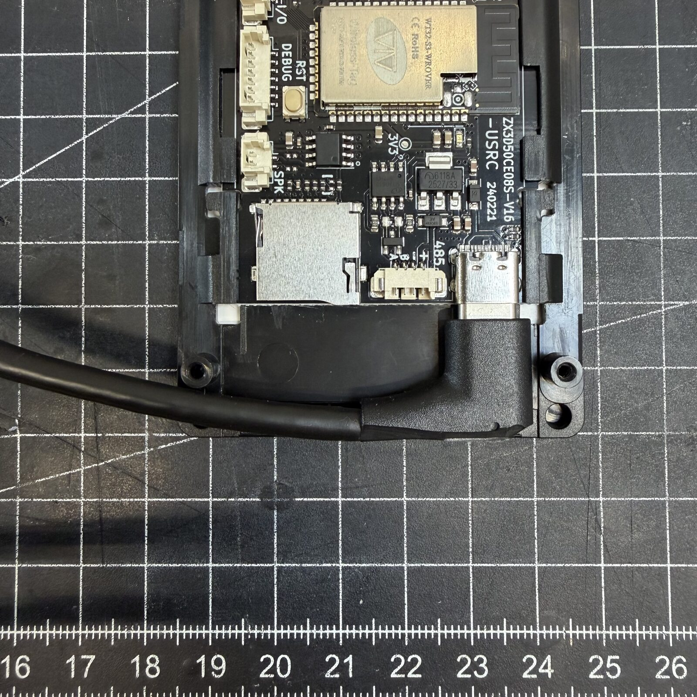
    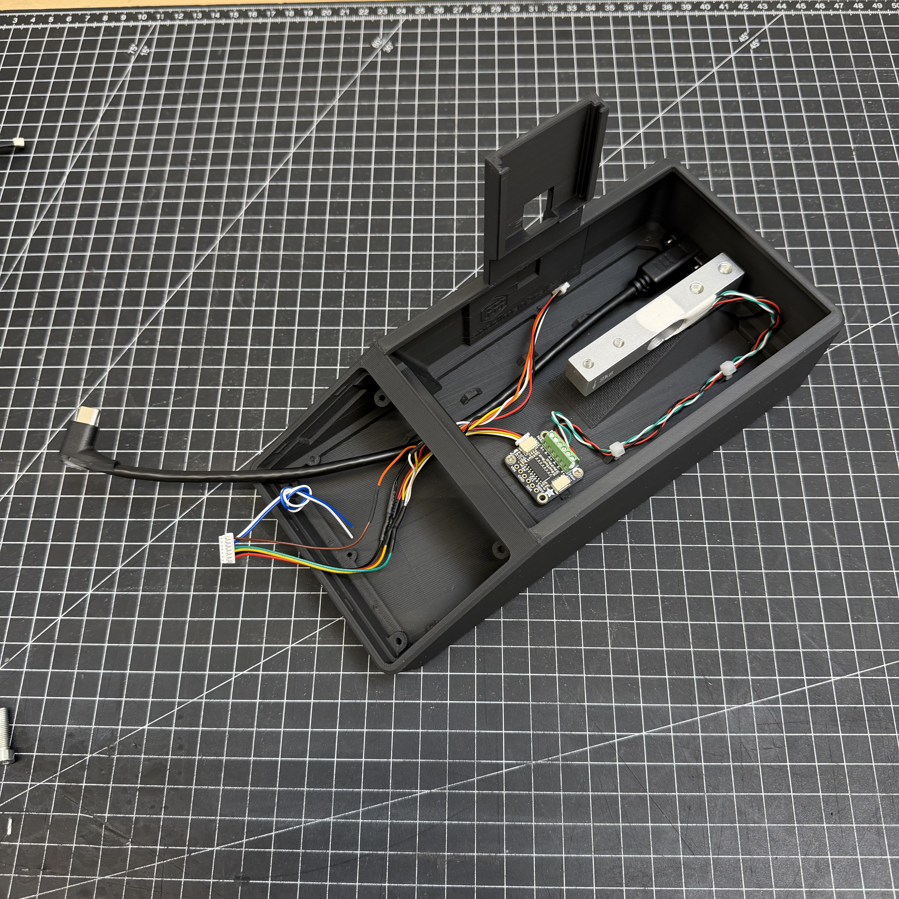
    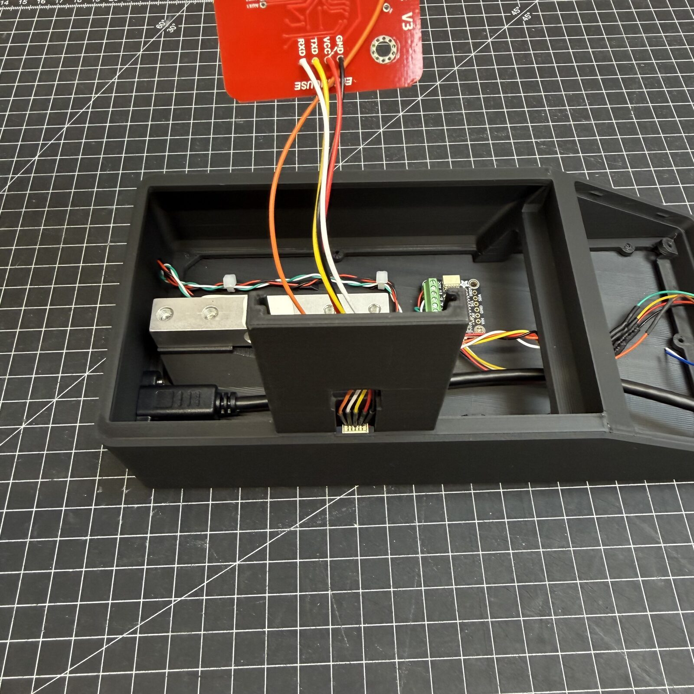
    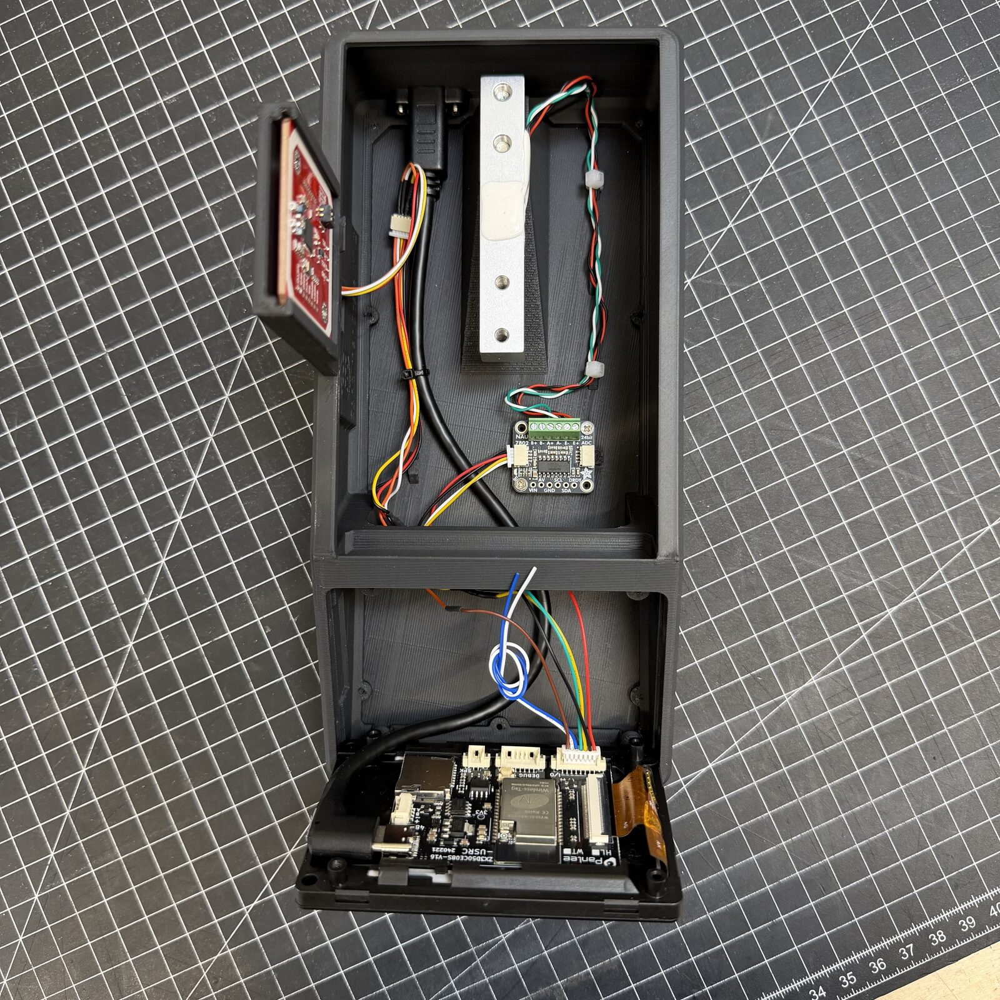

---

## 8. Power on, set up, calibrate

Now the scale gets set up: power it and go through the setup, language, WiFi,
server. Step by step under [Flashing & first setup](../use/index.md). At the
end the scale asks about calibration: tap **Calibrate now**.

!!! danger "Without calibration no weight is right"
    A new scale does not know how heavy anything is until you show it once.
    It takes a minute:

    1. **Settings → Spools & scale → Calibration**
    2. Scale empty, tap **TARE**
    3. Put on something of known weight, ideally about 1000 g, for example a
       full spool you have checked on a kitchen scale
    4. Type in the weight, tap **Calculate**

    More under [Weighing & calibration](../use/weighing.md).

Then: [Your first spools](../use/first-spools.md).

??? more "Something does not work?"
    The scale checks itself on every start and says in the status bar what is
    missing. What each message means is under
    [What the scale is telling you](../help/index.md). If a part does not fit
    for you, say so on [Discord](https://discord.gg/K3KmKnrWhP) or
    [MakerWorld](https://makerworld.com/de/models/2713675-spoolmanscale#profileId-3005075).
