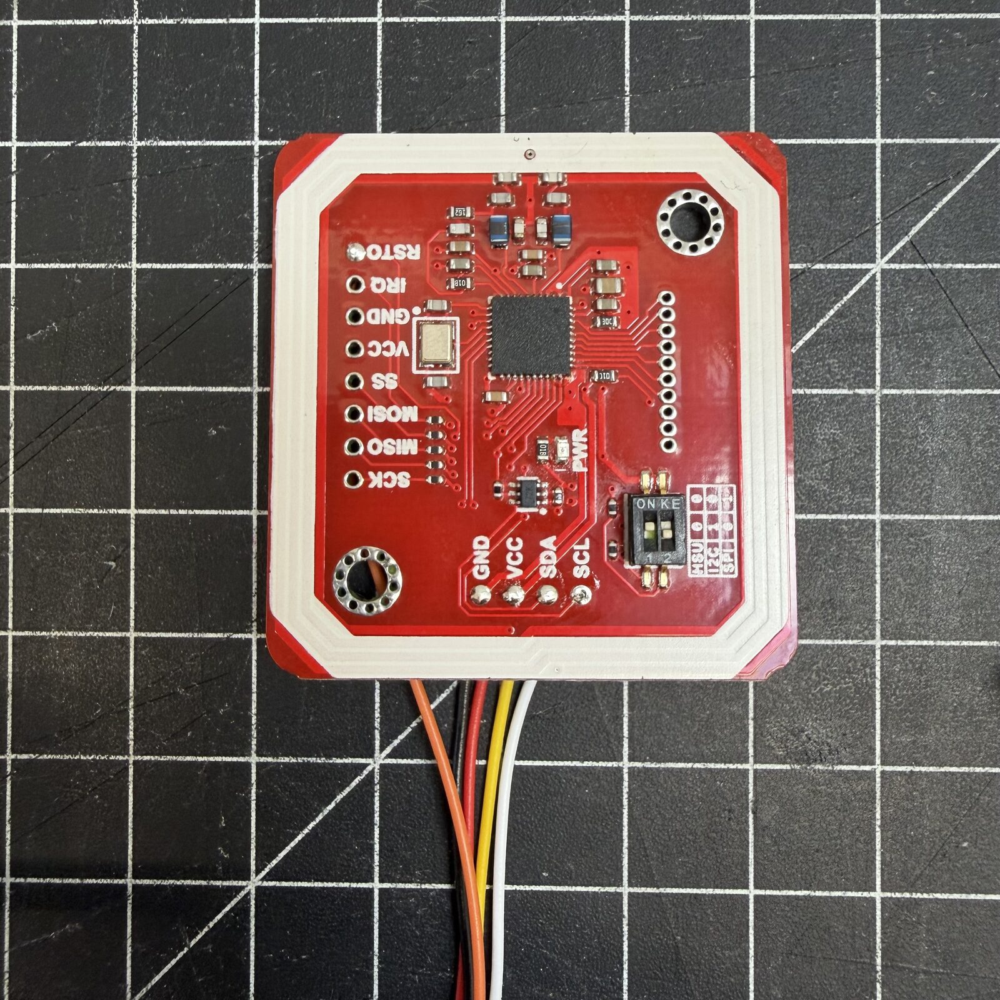
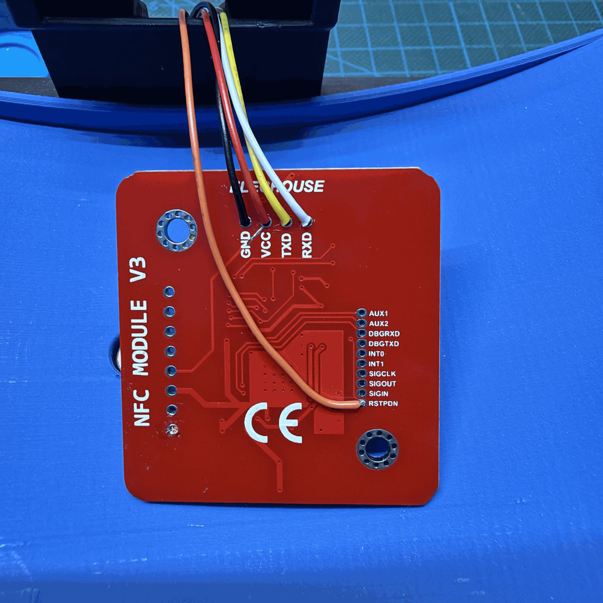

# Verkabelung

Zum Nachschlagen: alle Pins, Stecker und Farben. Die Kurzfassung mit
Zeichnung steht in der [Bauanleitung, Schritt 4](index.md#4-verkabeln).

---

## Die I/O-Buchse

Das 7-polige Kabel vom Display gehört **bündig links** in die 8-polige Buchse.
PN532 und NAU7802 hängen **parallel** an denselben vier Adern.

| Pin | Farbe | Signal | PN532 | NAU7802 |
|---|---|---|---|---|
| **1** | Rot | 5 V | VCC | VIN |
| **2** | Schwarz | GND | GND | GND |
| **3** | Gelb | GPIO10 (SDA) | SDA | SDA |
| **4** | Grün | GPIO11 (SCL) | SCL | SCL |
| **5** | Blau | GPIO12 | | |
| **6** | Weiß | GPIO13 | | |
| **7** | Braun | GPIO14 (Reset) | RSTPDN | |
| **8** | nicht im Kabel | GPIO21 | für später frei | |

Die Farben gelten für das mitgelieferte Kabel. Bei anderen Kabeln zählt die
Pinnummer.

??? more "Gesamtplan als Text"
    ```
      WT32-SC01 Plus I/O (Pins 1-7)
      ┌─────────────────────────────────────────┐
      │ Pin 1 (5V)   ───────┬─────────────────── PN532 VCC
      │                     └─────────────────── NAU7802 VIN
      │ Pin 2 (GND)  ───────┬─────────────────── PN532 GND
      │                     └─────────────────── NAU7802 GND
      │ Pin 3 (SDA)  ───────┬─────────────────── PN532 SDA
      │                     └─────────────────── NAU7802 SDA
      │ Pin 4 (SCL)  ───────┬─────────────────── PN532 SCL
      │                     └─────────────────── NAU7802 SCL
      │ Pin 7 (RST)  ─────────────────────────── PN532 RSTPDN
      └─────────────────────────────────────────┘

                                    NAU7802 Schraubklemmen
                                    ┌──────────────────────┐
                                    │ E+ ── Wägezelle ROT   │
                                    │ E- ── Wägezelle SCHW. │
                                    │ A+ ── Wägezelle WEISS │
                                    │ A- ── Wägezelle GRÜN  │
                                    └──────────────────────┘
    ```

---

## PN532 NFC-Reader

- **Schalter auf I2C:** Schalter 1 nach oben (ON), Schalter 2 nach unten. Im
  Zweifel gilt die Tabelle neben dem Schalter, Spalte I2C.
- **Von hinten löten**, vorne ist im Gehäuse kein Platz.
- **Reset an RSTPDN**, den letzten Pin der beschrifteten 10-poligen Reihe. Vor
  September 2026 gebaut? Siehe
  [PN532-Reset nachrüsten](../help/pn532-reset.md).
- **5 V direkt von Pin 1**, nie über den STEMMA-QT-Stecker der NAU7802 (nur
  3,3 V).

??? more "Fotos: Schalter vorne, Reset hinten"
    { width="400" }

    { width="400" }

---

## NAU7802 und Wägezelle

Die NAU7802 lötest du am sichersten an die beschrifteten Pads (VIN, GND, SDA,
SCL). Die Wägezelle kommt in die Schraubklemmen:

| Ader | Klemme | Funktion |
|---|---|---|
| Rot | E+ | Speisung + |
| Schwarz | E- | Speisung - |
| Weiß | A+ | Signal + |
| Grün | A- | Signal - |

Adern verdrillen und ohne Zug legen. Zeigt die Waage negative Werte, A+ und A-
tauschen.

---

## Pinreihenfolge der Stecker { #connector-pin-order }

Nur für Aufbauten mit Steckern. Kabel aus anderen Shops haben eigene Farben und oft
eine andere Reihenfolge: Prüf Ader für Ader nach Signal.

??? more "PN532, JST SH 1,0 mm, 5-polig"

    | PN532-Pin | Farbe (Fremdkabel) | Signal | WT32-Pin |
    |---|---|---|---|
    | 1 | Schwarz | GND | 2 (schwarz) |
    | 2 | Rot | 5V | 1 (rot) |
    | 3 | Gelb | SDA | 3 (gelb) |
    | 4 | Weiß | SCL | 4 (grün) |
    | 5 | Orange | **RSTPDN** | 7 (braun) |

??? more "NAU7802, STEMMA QT, JST SH 1,0 mm, 4-polig"

    | STEMMA-QT-Pin | Farbe (Fremdkabel) | Signal | WT32-Pin |
    |---|---|---|---|
    | 1 | Schwarz | GND | 2 (schwarz) |
    | 2 | Rot | 5V | 1 (rot) |
    | 3 | Gelb | SDA | 3 (gelb) |
    | 4 | Weiß | SCL | 4 (grün) |
