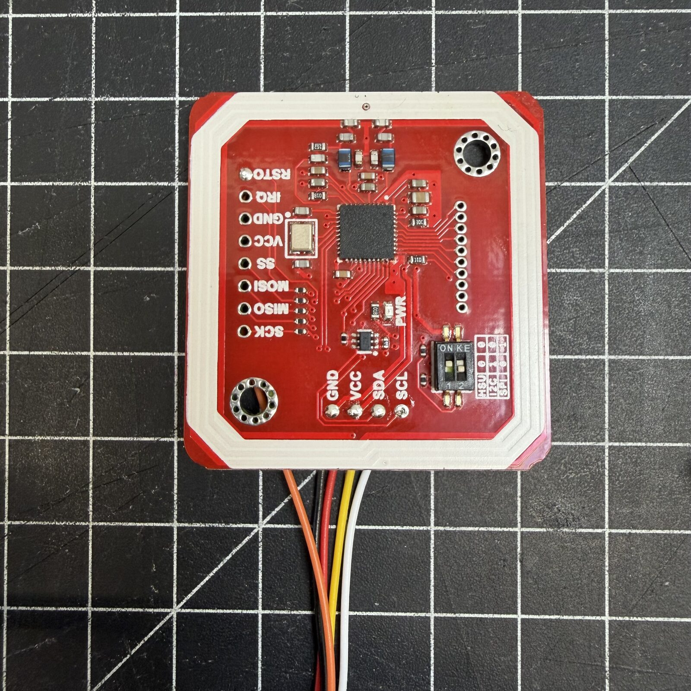

# Wiring

For reference: every pin, plug and colour. The short version with a drawing is
in the [build guide, step 4](index.md#4-wiring).

---

## The I/O socket

The 7-pin cable from the display goes **flush to the left** into the 8-pin
socket. The PN532 and the NAU7802 hang **in parallel** on the same four wires.

| Pin | Colour | Signal | PN532 | NAU7802 |
|---|---|---|---|---|
| **1** | Red | 5 V | VCC | VIN |
| **2** | Black | GND | GND | GND |
| **3** | Yellow | GPIO10 (SDA) | SDA | SDA |
| **4** | Green | GPIO11 (SCL) | SCL | SCL |
| **5** | Blue | GPIO12 | | |
| **6** | White | GPIO13 | | |
| **7** | Brown | GPIO14 (reset) | RSTPDN | |
| **8** | not in the cable | GPIO21 | free for later | |

The colours are those of the supplied cable. With other cables, the pin number
is what counts.

??? more "Overall plan as text"
    ```
      WT32-SC01 Plus I/O (pins 1-7)
      ┌─────────────────────────────────────────┐
      │ Pin 1 (5V)   ───────┬─────────────────── PN532 VCC
      │                     └─────────────────── NAU7802 VIN
      │ Pin 2 (GND)  ───────┬─────────────────── PN532 GND
      │                     └─────────────────── NAU7802 GND
      │ Pin 3 (SDA)  ───────┬─────────────────── PN532 SDA
      │                     └─────────────────── NAU7802 SDA
      │ Pin 4 (SCL)  ───────┬─────────────────── PN532 SCL
      │                     └─────────────────── NAU7802 SCL
      │ Pin 7 (RST)  ─────────────────────────── PN532 RSTPDN
      └─────────────────────────────────────────┘

                                    NAU7802 screw terminals
                                    ┌──────────────────────┐
                                    │ E+ ── Load cell RED   │
                                    │ E- ── Load cell BLACK │
                                    │ A+ ── Load cell WHITE │
                                    │ A- ── Load cell GREEN │
                                    └──────────────────────┘
    ```

---

## PN532 NFC reader

- **Switches to I2C:** switch 1 up (ON), switch 2 down. When in doubt, the
  table next to the switch decides, column I2C.
- **Solder from the back**, there is no room at the front inside the case.
- **Reset to RSTPDN**, the last pin of the labelled 10-pin row. Built before
  September 2026? See
  [Retrofitting the PN532 reset](../help/pn532-reset.md).
- **5 V straight from pin 1**, never through the NAU7802's STEMMA QT connector
  (3.3 V only).

??? more "Photos: switches at the front, reset at the back"
    { width="400" }

    { width="400" }

---

## NAU7802 and load cell

The NAU7802 is safest soldered to its labelled pads (VIN, GND, SDA, SCL). The
load cell goes into the screw terminals:

| Wire | Terminal | Function |
|---|---|---|
| Red | E+ | Excitation + |
| Black | E- | Excitation - |
| White | A+ | Signal + |
| Green | A- | Signal - |

Twist the wires and lay them without strain. If the scale shows negative
values, swap A+ and A-.

---

## Connector pin order { #connector-pin-order }

Only for builds with plugs. Cables from other shops have their own colours and
often a different order: check wire by wire, by signal.

??? more "PN532, JST SH 1.0 mm, 5-pin"

    | PN532 pin | Colour (third party) | Signal | WT32 pin |
    |---|---|---|---|
    | 1 | Black | GND | 2 (black) |
    | 2 | Red | 5V | 1 (red) |
    | 3 | Yellow | SDA | 3 (yellow) |
    | 4 | White | SCL | 4 (green) |
    | 5 | Orange | **RSTPDN** | 7 (brown) |

??? more "NAU7802, STEMMA QT, JST SH 1.0 mm, 4-pin"

    | STEMMA QT pin | Colour (third party) | Signal | WT32 pin |
    |---|---|---|---|
    | 1 | Black | GND | 2 (black) |
    | 2 | Red | 5V | 1 (red) |
    | 3 | Yellow | SDA | 3 (yellow) |
    | 4 | White | SCL | 4 (green) |
