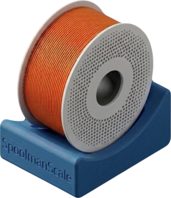
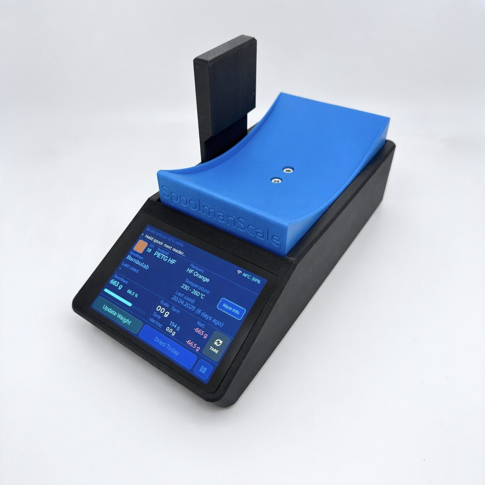
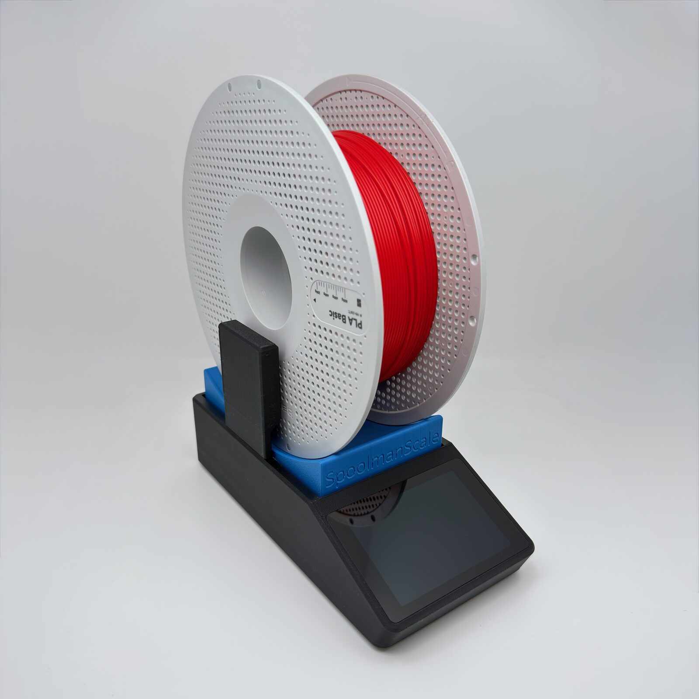

  

  
  

  <h1>SpoolmanScale</h1>
  
Open-source ESP32-S3 filament scale with NFC - talks to Spoolman, FilaMan and BamBuddy. No cloud<a href="#cloud-note">*</a>. No subscription. Just works.

  

    
    
    
  

  

  [:material-hammer-wrench: Build one](build/index.md){ .primary }
  [:material-printer-3d-nozzle: MakerWorld](https://makerworld.com/models/2713675){ .secondary }
  [:fontawesome-brands-github: GitHub](https://github.com/Niko11111/SpoolmanScale){ .secondary }
  

  
  

---

## What is SpoolmanScale?

A standalone filament scale for 3D printing. Put a spool on it and it identifies
the filament from its NFC tag, shows what is left, and syncs with your filament
manager - without opening a browser.

---

## New in v0.8.3

- 🧵 **Create spools on the scale** - from a Bambu tag, or from a blank NTAG:
  pick maker, material and colour from SpoolmanDB, FilaMan's FilamentDB or
  BamBuddy's catalogue, and the spool is created and linked in one go.
- ♻️ **Free the tag on archive** - archive an empty spool and the scale offers
  to unlink its tag; an NTAG on the pad is erased, ready for the next spool.
- 🏷️ **Labels on more printers** - NIIMBOT B1 and M2 (300 dpi) and the Phomemo
  M110S join the M220, M110 and M100. The editor in the browser has five
  arrangements and many more fields. [Recommended printers](use/printers.md)
- 🪟 **Inside BamBuddy or FilaMan** - the scale's web interface as a page in
  your backend, in its light or dark mode.
- ⚖️ **Auto-tare and optional bag** - a slow drift on the empty pad goes back to
  zero, and without a bag the main screen shows two lines instead of four.
- 🎨 **BamBuddy themes** and seven colour presets.

!!! note "Coming from 0.7.x?"
    0.8.3 needs the memory layout that came with 0.8.0. If your scale never
    had that one USB update, it shows a QR code to the
    [web flasher](https://niko11111.github.io/SpoolmanScale/) instead of
    updating: connect, choose **Update**, about 2 minutes, all settings are
    kept. From then on updates arrive over the air. [More](use/updating.md)

[All release notes on GitHub :material-arrow-right:](https://github.com/Niko11111/SpoolmanScale/releases/tag/v0.8.3){ .md-button }

---

## What it does

- 🔌 **Three backends** - [Spoolman, FilaMan or BamBuddy](use/backends.md),
  also over HTTPS, Spoolman also behind a key or password. Switch any time,
  your settings for the others are kept.
- 📡 **NFC identification** - put a spool down and it is identified: NTAG,
  Bambu Lab's own tags with colour name, drying and length, MIFARE Classic, a
  tag on each side of the spool if you like. [NFC tags](use/tags.md)
- 🧵 **New spools without a browser** - create filament and spool right at the
  scale, from a Bambu tag or a blank NTAG.
- ✍️ **Writing tags** - OpenSpool, FilaMan or Anycubic ACE format, on its own
  or on request, with every backend.
- ⚖️ **Precision scale** - 24-bit NAU7802 on a 2 kg load cell. Tare, auto-tare,
  bag weight, live difference to your inventory. [Weighing](use/weighing.md)
- 🏷️ **Label printing** - over Bluetooth on Phomemo and NIIMBOT printers, with
  a QR code to the spool and a label editor in the browser.
  [Labels](use/labels.md)
- 🖨️ **AMS view** - with FilaMan and BamBuddy: every bay with its spool,
  remaining filament and drying, and the drying recorded right from the card.
- 💧 **Drying reminder** - per material or one rule for everything, with a
  multiplier for airtight storage. [Drying & location](use/drying.md)
- 🎨 **Themes** - dark or light, in the look of Spoolman, FilaMan or BamBuddy,
  or in your own colours.
- 🌐 **Web interface** - separate pages in three languages, firmware updates
  from the browser, just as usable on a phone, and shown inside BamBuddy or
  FilaMan if you like. [Web interface](use/web.md)
- 🩺 **It says what is wrong** - the scale checks itself and names the fault in
  plain words, with the fix. [What the scale is telling you](help/index.md)
- 🔄 **Updates over WiFi** - the scale checks GitHub itself and installs over
  the air. [Updating](use/updating.md)
- 🏠 **Fully local** - no cloud\*, no account. Runs on your own network.

<small>* The scale itself needs no cloud and no account. If you want, it can
also use a backend that runs on the internet.</small>

---

## Hardware at a glance

| Component | Part |
|---|---|
| Microcontroller | ESP32-S3 (WT32-SC01 Plus) |
| Display | 3.5" IPS 480x320, capacitive touch |
| NFC reader | PN532 (I²C, `0x24`) |
| Scale ADC | NAU7802 (I²C, `0x2A`) |
| Load cell | 2 kg single point (5 kg works too) |
| Enclosure | 3D printed, free on MakerWorld |

Around **€50 to €60** in parts. Details on the
[bill of materials](build/bom.md).

---

## Where to start

=== "I want to build one"

    1. [Buy the parts](build/bom.md)
    2. [Print the case](build/case.md)
    3. [Wire it up](build/wiring.md)
    4. [Put it together](build/assembly.md)
    5. [Flash and set up](use/index.md)

=== "I have one already"

    - [Updating the firmware](use/updating.md)
    - [What is new in v0.8.3](https://github.com/Niko11111/SpoolmanScale/releases/tag/v0.8.3)
    - [The web interface](use/web.md)

=== "Something is wrong"

    - [What the scale is telling you](help/index.md) - it diagnoses itself
    - [Troubleshooting](help/troubleshooting.md)
    - [FAQ](help/faq.md)

=== "I need a server"

    The scale needs Spoolman, FilaMan or BamBuddy running somewhere.
    [SpoolmanScale Pro](pro/index.md) turns a Raspberry Pi into that
    server: installed with one command, then switched, backed up and
    updated from a web page, with the scale taken along.

---

## Community

- **Discord** - [discord.gg/K3KmKnrWhP](https://discord.gg/K3KmKnrWhP)
- **GitHub** - [github.com/Niko11111/SpoolmanScale](https://github.com/Niko11111/SpoolmanScale)
- **MakerWorld** - [@FormFollowsF](https://makerworld.com/de/models/2713675-spoolmanscale#profileId-3005075)
- **Ko-fi** - [Support the project](https://ko-fi.com/formfollowsfunction)

!!! tip "Want to help?"
    Found a bug? Missing something? See [Contributing](help/contributing.md) or
    open an issue on GitHub.
