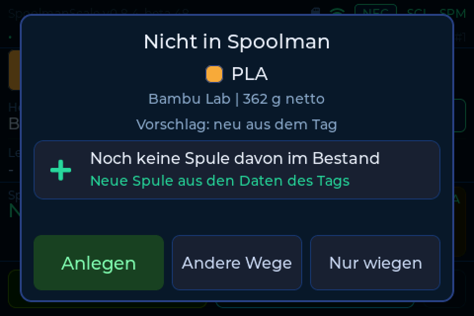
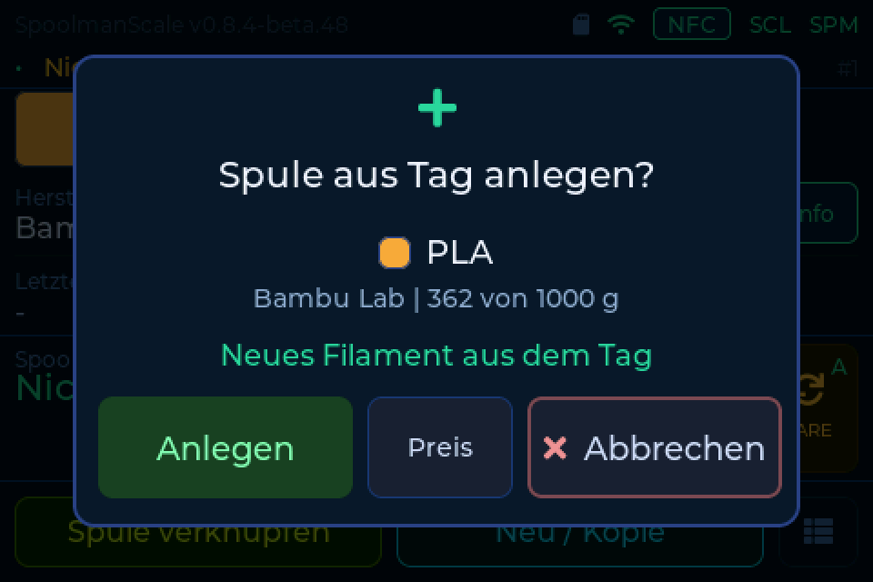
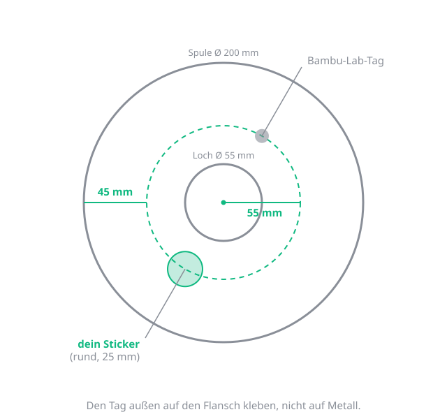
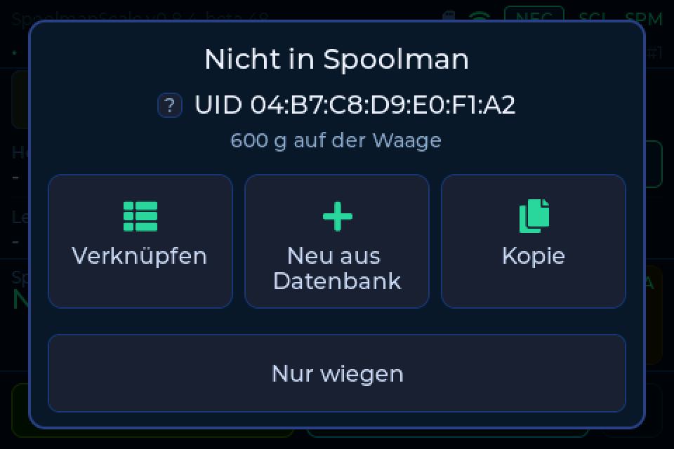
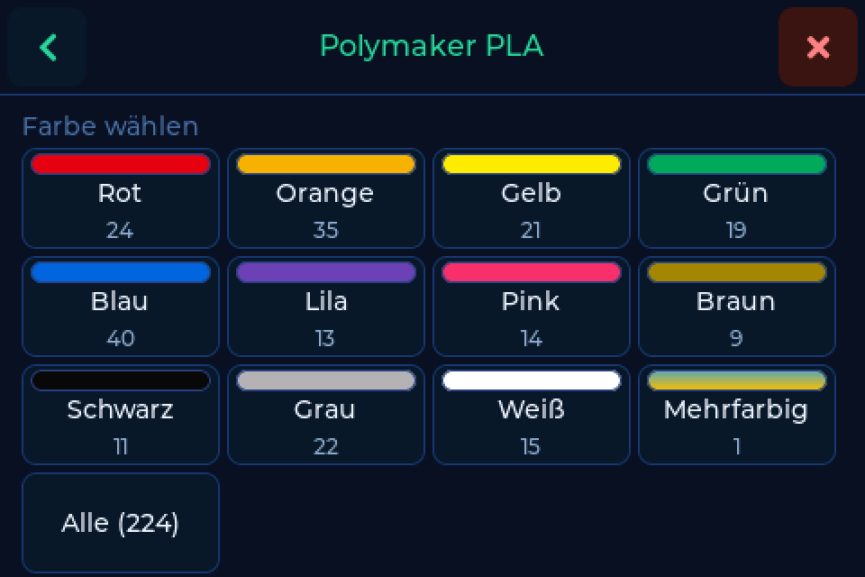
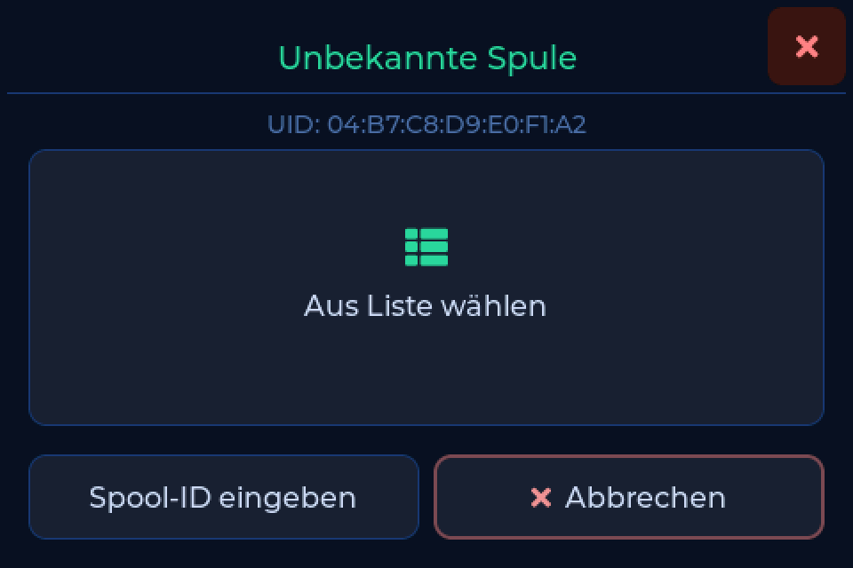
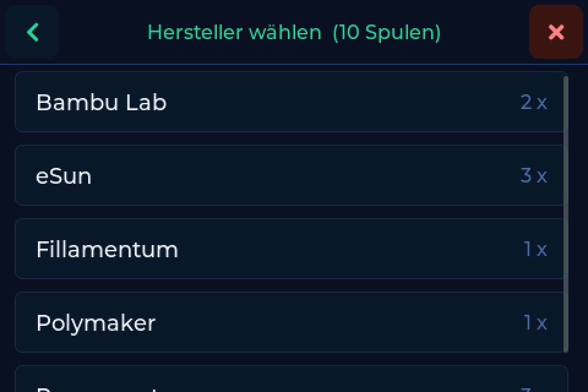
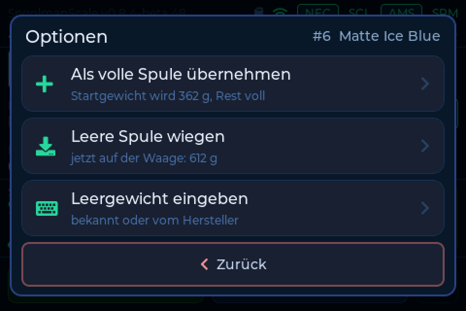
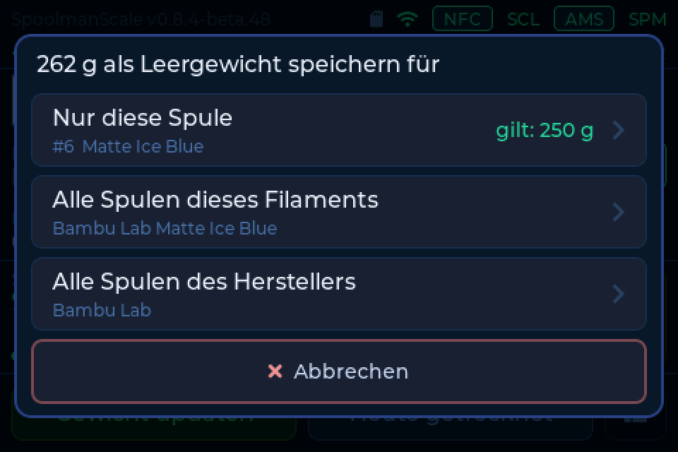

# Deine ersten Spulen

Die Waage erkennt eine Spule an ihrem NFC-Tag. Du brauchst ein
[Backend](backends.md) (Spoolman, FilaMan oder BamBuddy) und für jede Spule ein
Tag. Manche Spulen haben schon eins eingebaut, bei allen anderen klebst du
einen Sticker auf.

---

## Spule mit Tag vom Hersteller

Leg die Spule auf. Kennt dein Backend sie noch nicht, fragt die Waage, ob sie
sie anlegen soll. Hersteller, Material und Farbe kommen aus dem Tag, das
Gewicht misst die Waage. Das geht heute bei **Bambu Lab**.

Immer mehr Hersteller bauen NFC-Tags in ihre Spulen. Wir wollen sie alle
lesen, damit du eine Spule mit einem Tap anlegst oder verknüpfst. Das gilt auch
für Spulen, die du selbst mit einem beschriebenen Tag ausgestattet hast. So
steht es heute:

| Format | Stand |
|---|---|
| Bambu Lab | Anlegen aus dem Tag **funktioniert** |
| OpenSpool | wird gelesen, Anlegen aus den Daten in Aussicht |
| FilaMan | wird gelesen, Anlegen aus den Daten in Aussicht |
| Anycubic ACE | wird gelesen, Anlegen aus den Daten in Aussicht |
| Snapmaker | wird gelesen (Schalter in den Web-Einstellungen), Anlegen in Aussicht |
| Creality CFS | in Arbeit (Firmware 0.8.4) |
| TigerTag | in Aussicht |
| OpenTag3D | in Aussicht |
| Elegoo Canvas | in Aussicht |
| Qidi Box | in Aussicht |
| Prusa OpenPrintTag | noch nicht möglich, Hardware-Upgrade in Planung |

Jeder Tag mit einem NTAG-Chip wird außerdem an seiner UID erkannt und lässt sich
mit einer Spule verknüpfen. Die vollständige Liste mit allen Details steht unter
[Spulen, Tags & Drucker](compatibility.md). Das sind Absichten, keine Zusagen
und keine Termine.

Was auf einem fremden Tag steht, kann jeder hineinschreiben. Die Waage zeigt
darum immer, was sie anlegen will, bevor sie es tut.

---

## Spule ohne Tag

Klebe einen **NTAG215**-Sticker (rund, 25 mm) außen auf den Flansch, 55 mm von
der Spulenmitte. Nicht auf Metall. 50 Stück kosten etwa 10 Euro/Dollar. Welche
Tags sonst gehen, steht unter [NFC-Tags](tags.md).

Leg die Spule auf und wähle **Neu aus Datenbank**. Dann Hersteller, Material
und Farbe wählen, fertig.

??? tip "Sticker auf beide Seiten kleben"
    Schalte unter **Einstellungen → Verbindung → Weitere Optionen** **Zweites
    Tag abfragen** ein. Nach dem Verknüpfen bittet dich die Waage, die Spule
    umzudrehen und das zweite Tag aufzulegen. Das geht mit Spoolman ab 0.27 und
    FilaMan ab 1.3.1.

    

??? info "Der Eintrag fehlt in der Datenbank"
    Lege eine ähnliche Spule an und ändere die Farbe im Backend. Oder lege die
    Spule im Backend an und verknüpfe sie danach an der Waage.

---

## Eine Spule verknüpfen

Steht die Spule schon in deinem Backend, musst du nur das Tag verknüpfen. Leg
die Spule auf und tippe auf **Verknüpfen**. Dann wählst du die Spule aus der
Liste, nach Hersteller, Material und Farbe sortiert, oder du gibst die
Spulen-ID deines Backends ein.

Das geht mit jedem Tag, auch mit denen, die schon Daten tragen. Die Daten auf
dem Tag zu nutzen, um die richtige Spule vorzuschlagen, ist in Aussicht. Mehr
zum Verknüpfen und zu Spulen mit mehreren Tags steht unter
[NFC-Tags](tags.md).

---

## Angefangene Spule und Leergewicht

Die Waage rechnet *Gewicht auf der Waage minus Leerspule*. Das Leergewicht
kommt als Startwert aus der Datenbank deines Backends (Spule, dann Filament,
dann Hersteller), sonst gelten 250 g.

Stimmt der Wert nicht, zum Beispiel bei Billigware oder einem selbst gedruckten
Kern: Tippe auf **Update Weight**, dann **Optionen**, und wähle **Leere Spule
wiegen** oder **Leergewicht eingeben**. Danach wählst du, wofür der Wert gilt.

Ein Beispiel: 612 g auf der Waage, 250 g Leerspule, also 362 g Filament. Liegt
das Leergewicht 30 g daneben, ist das etwa 3 % einer 1-kg-Spule.

??? info "Je nach Backend"
    Spoolman und FilaMan: nur diese Spule, alle Spulen des Filaments oder alle
    des Herstellers. BamBuddy mit eigenem Inventar: nur diese Spule. BamBuddy
    mit Spoolman dahinter: trage das Leergewicht im Spoolman selbst ein.

Kennst du das Leergewicht nicht, wiegst du die Spule einfach leer.
