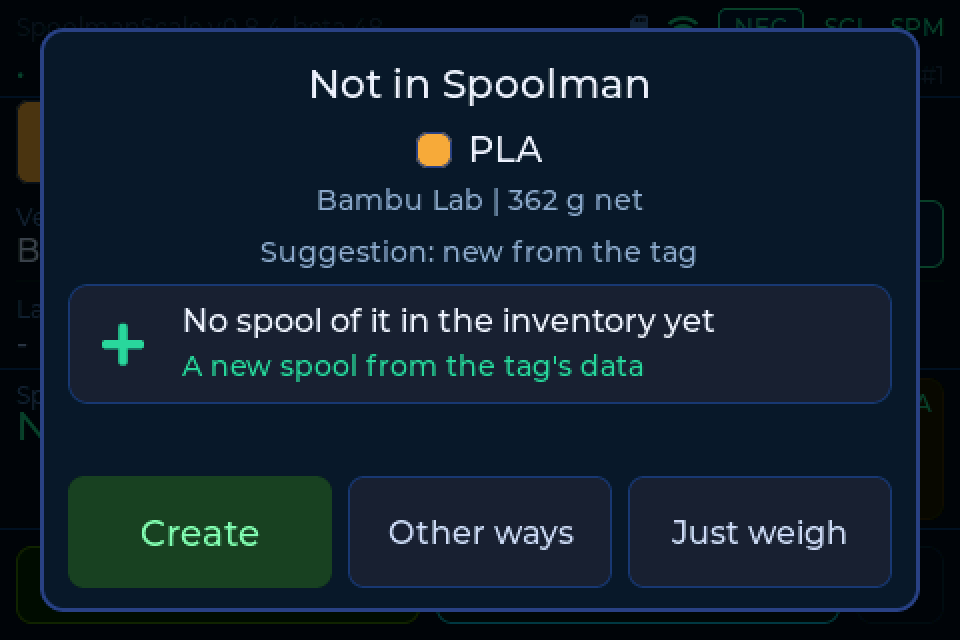
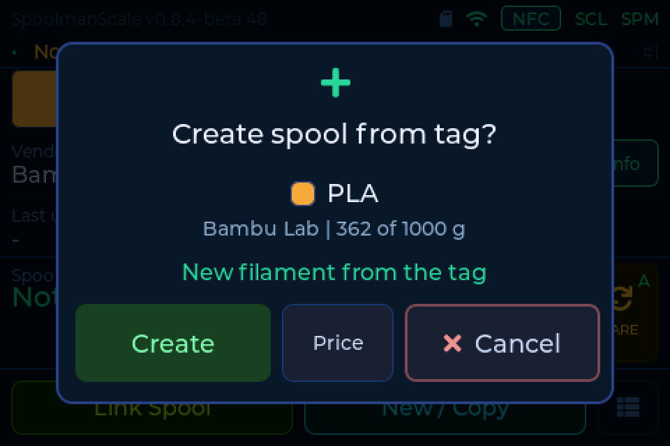
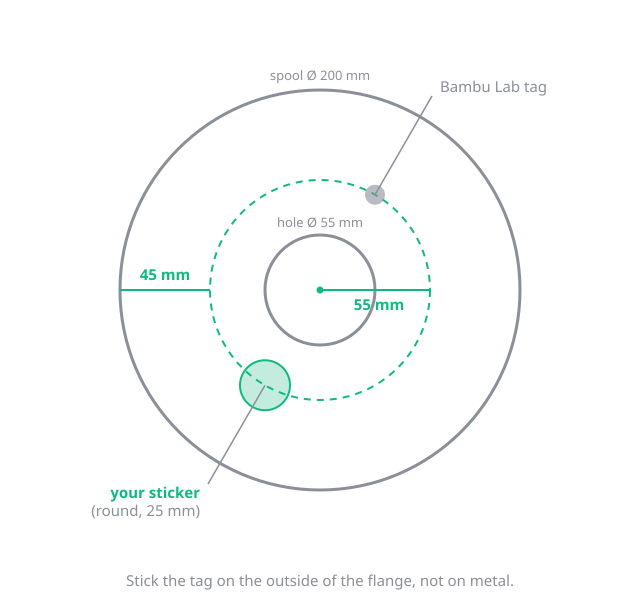
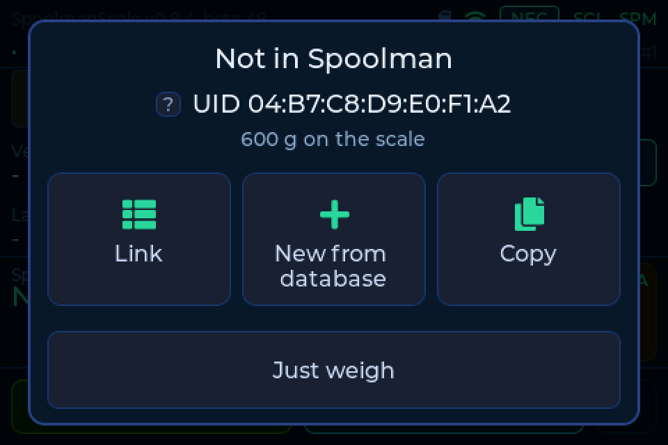
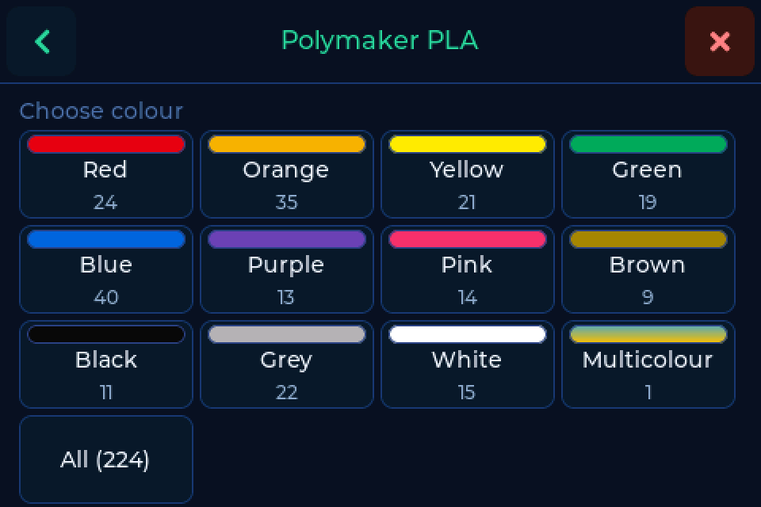
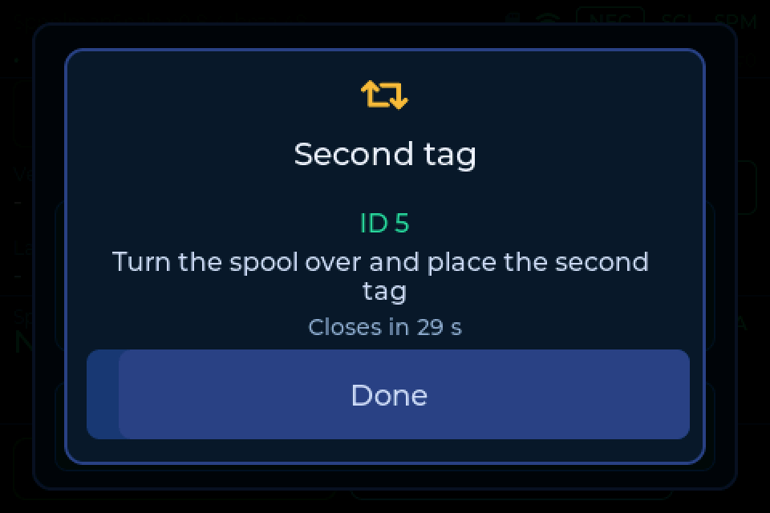
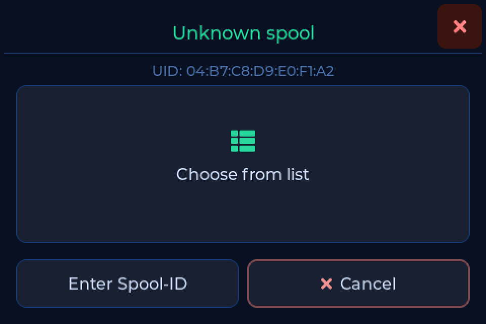
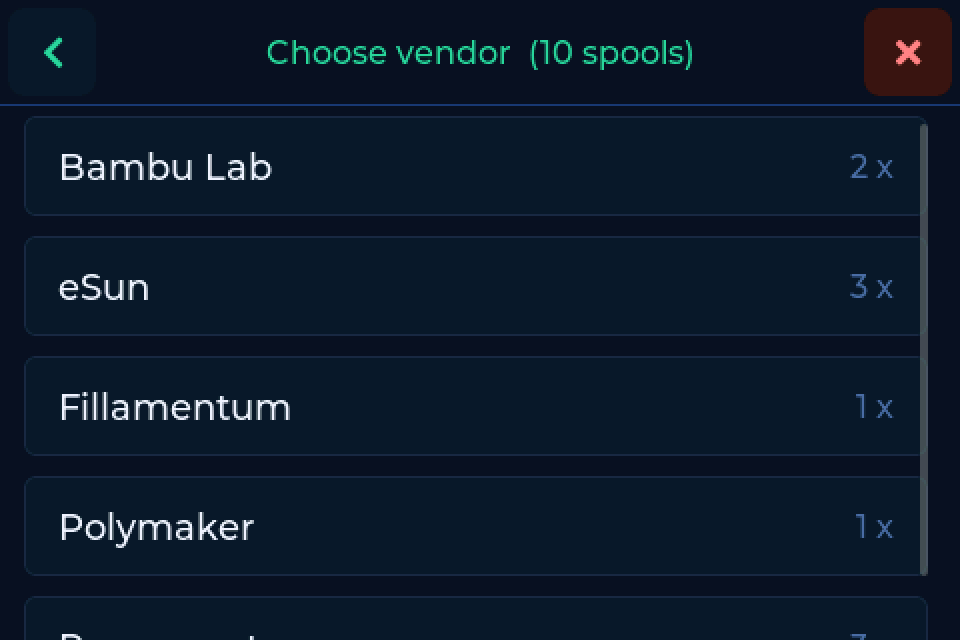
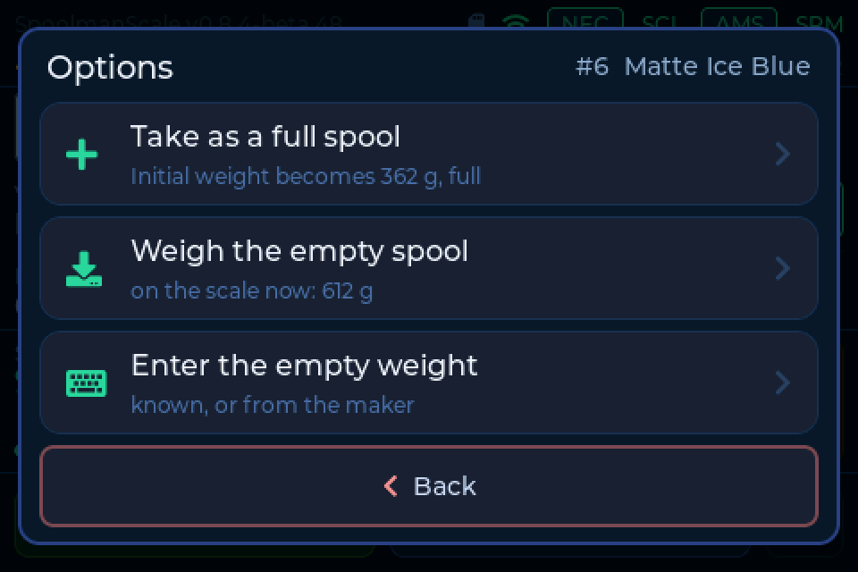
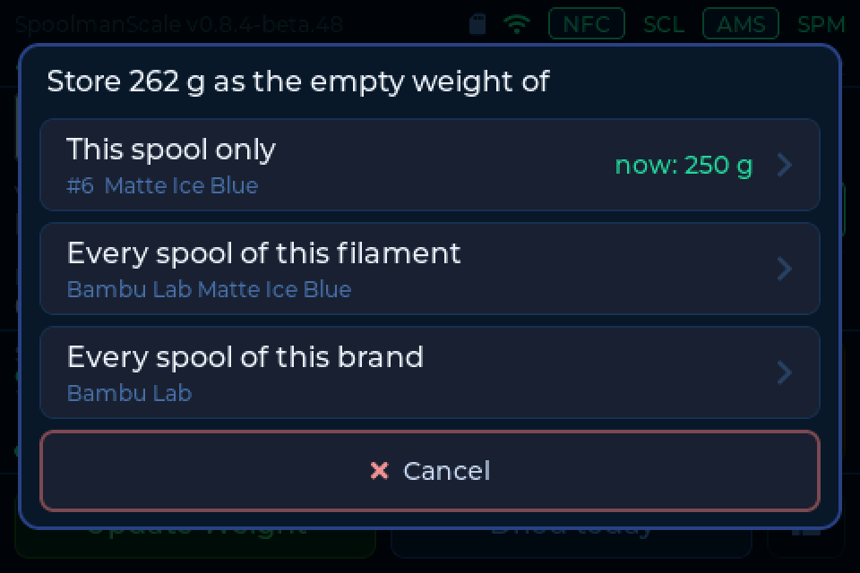

# Your first spools

The scale recognises a spool by its NFC tag. You need a
[backend](backends.md) (Spoolman, FilaMan or BamBuddy) and a tag on every
spool. Some spools come with one built in; on all others you stick one on.

---

## A spool with the maker's tag

Put the spool on. If your backend does not know it yet, the scale asks whether
to create it. Vendor, material and colour come from the tag, and the scale
measures the weight. Today this works with **Bambu Lab**.

More and more makers put NFC tags in their spools. We want to read them all, so
that you create or link a spool with one tap. That includes spools you fitted
with a written tag yourself. This is where things stand:

| Format | Status |
|---|---|
| Bambu Lab | creating from the tag **works** |
| OpenSpool | is read, creating from its data planned |
| FilaMan | is read, creating from its data planned |
| Anycubic ACE | is read, creating from its data planned |
| Snapmaker | is read (switch in the web settings), creating planned |
| Creality CFS | in progress (firmware 0.8.4) |
| TigerTag | planned |
| OpenTag3D | planned |
| Elegoo Canvas | planned |
| Qidi Box | planned |
| Prusa OpenPrintTag | not possible yet, hardware upgrade planned |

Any tag with an NTAG chip is also recognised by its UID and can be linked to a
spool. The full list with all details is under
[Spools, tags & printers](compatibility.md). These are intentions, not promises
and not dates.

Anybody can write to a tag that is not from a maker. The scale therefore always
shows what it is about to create before it does.

---

## A spool without a tag

Stick an **NTAG215** sticker (round, 25 mm) on the outside of the flange, 55 mm
from the centre of the spool. Not on metal. 50 of them cost about 10
euros/dollars. Other tags that work are listed under [NFC tags](tags.md).

Put the spool on and choose **New from database**. Then pick vendor, material
and colour, and you are done.

??? tip "Stick a tag on both sides"
    Turn on **Ask for a second tag** under **Settings → Connection → More
    options**. After linking, the scale asks you to flip the spool and put the
    second tag on. This works with Spoolman 0.27 and later and FilaMan 1.3.1
    and later.

    

??? info "The entry is missing from the database"
    Create a similar spool and change the colour in the backend. Or create the
    spool in the backend and link it at the scale afterwards.

---

## Linking a spool

If the spool is already in your backend, you only need to link the tag. Put the
spool on and tap **Link**. Then pick the spool from the list, sorted by vendor,
material and colour, or enter the spool ID from your backend.

This works with every tag, including those that already carry data. Using the
data on the tag to suggest the right spool is planned. More on linking and on
spools with several tags is under [NFC tags](tags.md).

---

## A part-used spool and the empty weight

The scale works out *weight on the scale minus the empty spool*. The empty
weight starts from your backend's database (spool, then filament, then vendor),
otherwise 250 g applies.

If the value is wrong, for example on cheap filament or a printed core, tap
**Update Weight**, then **Options**, and choose **Weigh the empty spool** or
**Enter the empty weight**. Then you pick what the value applies to.

An example: 612 g on the scale, 250 g empty spool, so 362 g of filament. If the
empty weight is 30 g off, that is about 3 % of a 1 kg spool.

??? info "Depends on the backend"
    Spoolman and FilaMan: this spool only, all spools of the filament, or all
    of the vendor. BamBuddy with its own inventory: this spool only. BamBuddy
    with Spoolman behind it: enter the empty weight in Spoolman itself.

If you do not know the empty weight, weigh the spool once it is empty.
