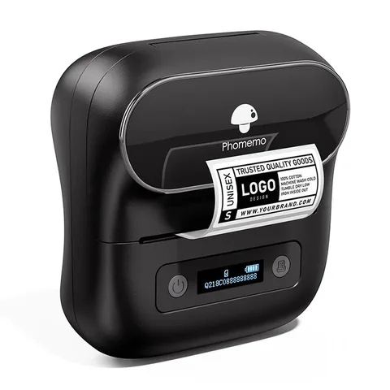
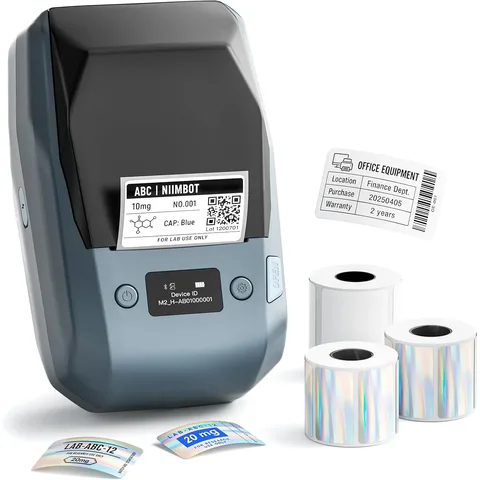

# Etikettendrucker

Zwei Drucker empfehlen wir: Sie sind von uns aus erster Hand verifiziert, und
jede neue Etikettenfunktion wird zuerst auf ihnen gebaut und getestet. Die
übrigen Modelle sind durch Rückmeldungen aus der Community freigegeben.

Die Shop-Links auf dieser Seite sind Affiliate-Links (mit * markiert). Für dich
kostet das Produkt genau gleich viel. Kaufst du darüber, fließt eine kleine
Provision in die Weiterentwicklung von SpoolmanScale. Als Amazon-Partner
verdiene ich an qualifizierten Verkäufen.

## Welcher passt zu dir?

| | Phomemo M220 | NIIMBOT M2 |
|---|---|---|
| Preis | günstiger | etwas teurer, dazu Farbband |
| Verfahren | Thermodirekt: Wärme färbt das Papier | Thermotransfer: Farbe vom Farbband |
| Auflösung | 203 dpi | 300 dpi |
| Im Trockner | Etikett wird schwarz | Etikett bleibt lesbar |
| Gut für | Boxen, Regale, ungetrocknete Spulen | Spulen für Trockner und AMS HT |

**Shop:**

## Phomemo M220

Günstig, ohne Farbband, Etiketten mit **40 x 30** und **50 x 30 mm**.

!!! warning "Nicht für den Trockner"
    Im AMS HT bei 85 °C wird das Etikett meist schon beim ersten Trocknen
    schwarz, bei niedrigeren Temperaturen nach und nach.

{ width="240" loading=lazy }

<a class="shop-link md-button" data-product="phomemo-m220">Phomemo M220</a>
<a class="shop-link md-button" data-product="phomemo-m220-40x30">Etiketten 40 x 30 mm</a>
<a class="shop-link md-button" data-product="phomemo-m220-50x30">Etiketten 50 x 30 mm</a>

## NIIMBOT M2

Übersteht den Trockner, und mit 300 dpi werden Schrift und QR-Code feiner.
Etiketten mit **50 x 30 mm**.

Getestet mit der originalen weißen NIIMBOT-Rolle 50 x 30 mm und schwarzem
Farbband. Rollen anderer Hersteller haben wir nicht ausprobiert.

{ width="240" loading=lazy }

<a class="shop-link md-button" data-product="niimbot-m2">NIIMBOT M2</a>
<a class="shop-link md-button" data-product="niimbot-m2-labels">Etiketten</a>
<a class="shop-link md-button" data-product="niimbot-m2-ribbon">Farbband</a>

## Weitere unterstützte Drucker

| Drucker | Etiketten | Status |
|---|---|---|
| Phomemo M110, M110S, M100 | 40 x 30 mm | durch Nutzer bestätigt |
| NIIMBOT B1, B21, B203 | 50 x 30 mm | durch Nutzer bestätigt |
| Phomemo M120, M200, M221 | 40 x 30 mm | experimentell |

Alle drucken per Thermodirekt mit 203 dpi, also gilt die Trockner-Warnung auch
hier. **Durch Nutzer bestätigt** heißt: Jemand aus der Community hat darauf
gedruckt, wir selbst haben den Drucker nicht. **Experimentell** heißt: gleiches
Protokoll, aber noch kein Druck. Hast du einen, freuen wir uns über deine
Rückmeldung.

## Was ein Drucker können muss { #printer-needs }

Damit die Waage einen Etikettendrucker ansprechen kann, braucht er drei Dinge:

1. **Bluetooth Low Energy (BLE).** Die Waage funkt mit einem ESP32-S3, und der
   kann nur BLE.
2. **Ein Protokoll, das wir kennen.** Heute sind das die Familien von Phomemo
   und NIIMBOT. Jeder weitere Hersteller braucht einen eigenen Treiber und
   jemanden, der damit testet.
3. **Genug Platz auf dem Etikett.** Für QR-Code und ein paar Angaben braucht es
   etwa 18&nbsp;mm bedruckbare Höhe. Bei Bandgeräten heißt das: mindestens
   24&nbsp;mm breites Band.

??? info "Warum Brother-Drucker nicht gehen"
    Hinter „Bluetooth“ stecken zwei verschiedene Funkverfahren: das ältere
    Bluetooth Classic und Bluetooth Low Energy. Handys können beides, deshalb
    fällt der Unterschied sonst nie auf. Brothers P-touch-Drucker (etwa
    PT-P300BT, PT-P710BT, PT-E560BT) nutzen Classic, der Chip der Waage kann
    nur BLE. Ein Update ändert daran nichts, es fehlt die Funkhardware.

    **So erkennst du es:** Steht im Datenblatt **SPP** oder **iAP2**, ist es
    Bluetooth Classic. „Bluetooth 5.0“ allein heißt nicht BLE, das ist nur die
    Version der Spezifikation. Sicher zeigt es die kostenlose App
    **nRF Connect**: Taucht der Drucker dort auf, spricht er BLE.

## Etikettengrößen

Abgestimmt sind die gängigsten Größen, **40 x 30** und **50 x 30 mm**. Du
brauchst eine andere? Schreib uns auf
[GitHub](https://github.com/Niko11111/SpoolmanScale/issues) oder im
[Discord](../help/contributing.md). Was mehrere brauchen, nehmen wir auf.
