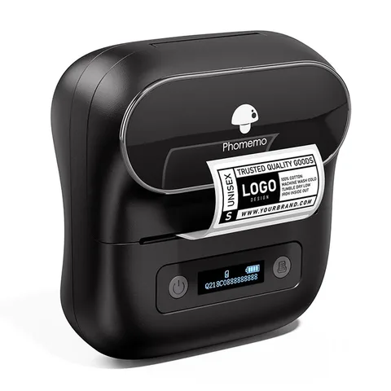
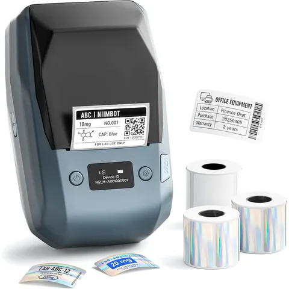
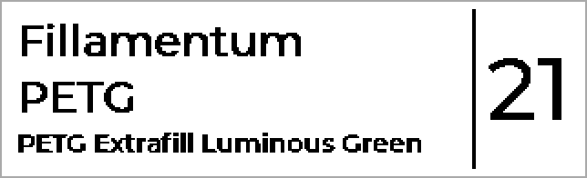

# Label printers

We recommend two printers: we verified them first-hand, and every new label
feature is built and tested on them first. The other models were cleared by
feedback from the community.

The shop links on this page are affiliate links (marked with *). The product
costs you exactly the same. If you buy through them, a small commission goes
into the development of SpoolmanScale. As an Amazon Associate I earn from
qualifying purchases. En tant que Partenaire Amazon, je réalise un bénéfice sur
les achats remplissant les conditions requises.

## Which one suits you?

| | Phomemo M220 | NIIMBOT M2 |
|---|---|---|
| Price | cheaper | a bit more, plus ribbon |
| Method | direct thermal: heat colours the paper | thermal transfer: ink from a ribbon |
| Resolution | 203 dpi | 300 dpi |
| In the dryer | label turns black | label stays readable |
| Good for | boxes, shelves, spools not dried | spools for a dryer or the AMS HT |

**Shop:**

## Phomemo M220

Cheap, no ribbon, labels of **40 x 30** and **50 x 30 mm**.

!!! warning "Not for the dryer"
    In the AMS HT at 85 °C the label mostly turns black on the first drying,
    at lower temperatures bit by bit.

{ width="240" loading=lazy }

<a class="shop-link md-button" data-product="phomemo-m220">Phomemo M220</a>
<a class="shop-link md-button" data-product="phomemo-m220-40x30">Labels 40 x 30 mm</a>
<a class="shop-link md-button" data-product="phomemo-m220-50x30">Labels 50 x 30 mm</a>

## NIIMBOT M2

Stands the dryer, and at 300 dpi text and QR code come out finer. Labels of
**50 x 30 mm**.

Tested with NIIMBOT's original white 50 x 30 mm roll and the black ribbon.
Third-party rolls we have not tried.

{ width="240" loading=lazy }

<a class="shop-link md-button" data-product="niimbot-m2">NIIMBOT M2</a>
<a class="shop-link md-button" data-product="niimbot-m2-labels">Labels</a>
<a class="shop-link md-button" data-product="niimbot-m2-ribbon">Ribbon</a>

## Other supported printers

| Printer | Labels | Status |
|---|---|---|
| Phomemo M110, M110S, M100 | 40 x 30 mm | confirmed by users |
| NIIMBOT B1, B21, B203 | 50 x 30 mm | confirmed by users |
| Phomemo M120, M200, M221 | 40 x 30 mm | experimental |
| NIIMBOT D110, D110 M | 12 x 40 mm, no QR code ([Narrow tape](#tape)) | D110 M confirmed by users, D110 experimental |
| Phomemo PM245-BT, PM241-BT | 40 x 30, 50 x 30 mm | PM245-BT confirmed by users, PM241-BT experimental |

All of them print direct thermal at 203 dpi, so the dryer warning applies here
too. **Confirmed by users** means someone from the community printed on it; we
do not have the printer ourselves. **Experimental** means the same protocol,
but no print yet. If you have one, we would love to hear from you.

## Narrow tape: NIIMBOT D110 and D110 M { #tape }

The D110 prints on **12 x 40 mm** rolls. A QR code does not fit on 12&nbsp;mm, so
it gets a fixed label: maker, material and name on the left, the spool ID large
on the right. The filament label comes without a number.

{ width="320" loading=lazy }

In the [web interface](web.md), the template under **Labels** is greyed out for
this printer, and the preview shows the finished label. Your template stays
saved and applies again once you pick another printer. FilaMan's presets are
not used here.

So far one user has printed on a D110 M with the T12\*40-160 roll. The plain
D110 has not printed yet.

!!! note "Other rolls"
    The scale only offers 12 x 40 mm and does not detect which roll is loaded.
    The print head is 12&nbsp;mm wide. So on a 14 or 15 mm roll the print stays
    12&nbsp;mm across the tape, and a longer label is only printed on 40&nbsp;mm
    of its length. We have not tried this yet. If you have such a roll, a photo
    showing where the print sits helps us.

## What a printer needs { #printer-needs }

For the scale to drive a label printer, the printer needs three things:

1. **Bluetooth Low Energy (BLE).** The scale's radio is an ESP32-S3, and it
   only speaks BLE.
2. **A protocol we know.** Today that is the Phomemo and NIIMBOT families.
   Every other brand needs a driver of its own and someone to test it.
3. **Enough room on the label.** A QR code plus a few details need about
   18&nbsp;mm of printable height. On tape printers that means tape at least
   24&nbsp;mm wide. Without a QR code less will do: the
   [NIIMBOT D110](#tape) gets by on 12&nbsp;mm.

??? info "Why Brother printers don't work"
    "Bluetooth" is really two different radio standards: the older Classic
    Bluetooth and Bluetooth Low Energy. Phones speak both, so you normally never
    notice. Brother's P-touch printers (such as the PT-P300BT, PT-P710BT and
    PT-E560BT) use Classic, while the scale's chip only has BLE. No update can
    change that, the radio hardware is missing.

    **How to tell:** If the data sheet says **SPP** or **iAP2**, it is Classic
    Bluetooth. "Bluetooth 5.0" alone does not mean BLE, it is only the version
    of the specification. The free app **nRF Connect** tells you for sure: if
    the printer shows up there, it speaks BLE.

## Label sizes

The most common sizes are tuned, **40 x 30** and **50 x 30 mm**, plus
**60 x 30 mm** for the 3 inch Phomemo printers (M220, M200, M221, PM245-BT) and
**12 x 40 mm** for the [NIIMBOT D110](#tape). Need another one? Tell us on [GitHub](https://github.com/Niko11111/SpoolmanScale/issues) or
on [Discord](../help/contributing.md). What several people need, we add.
