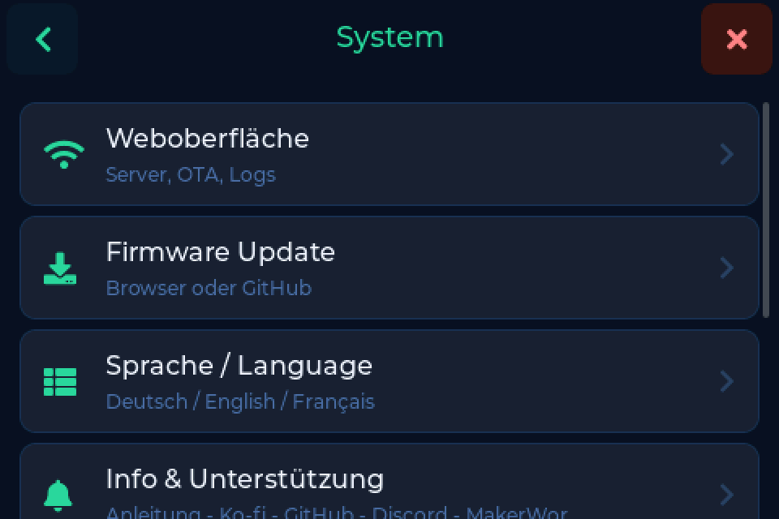
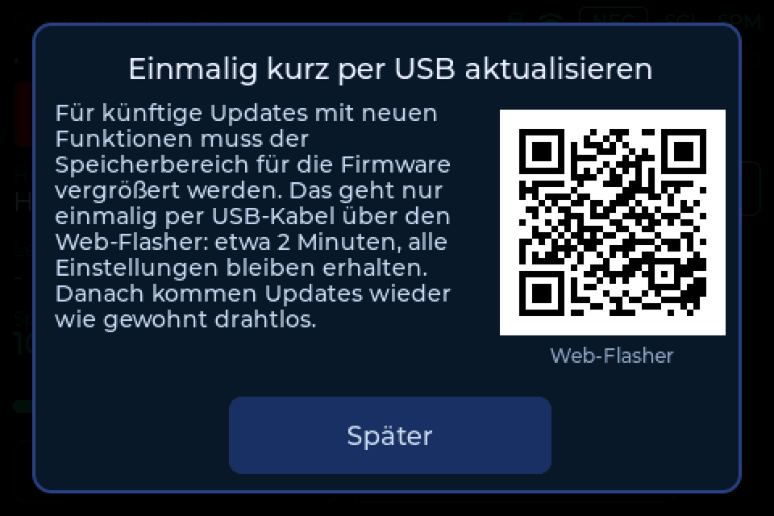
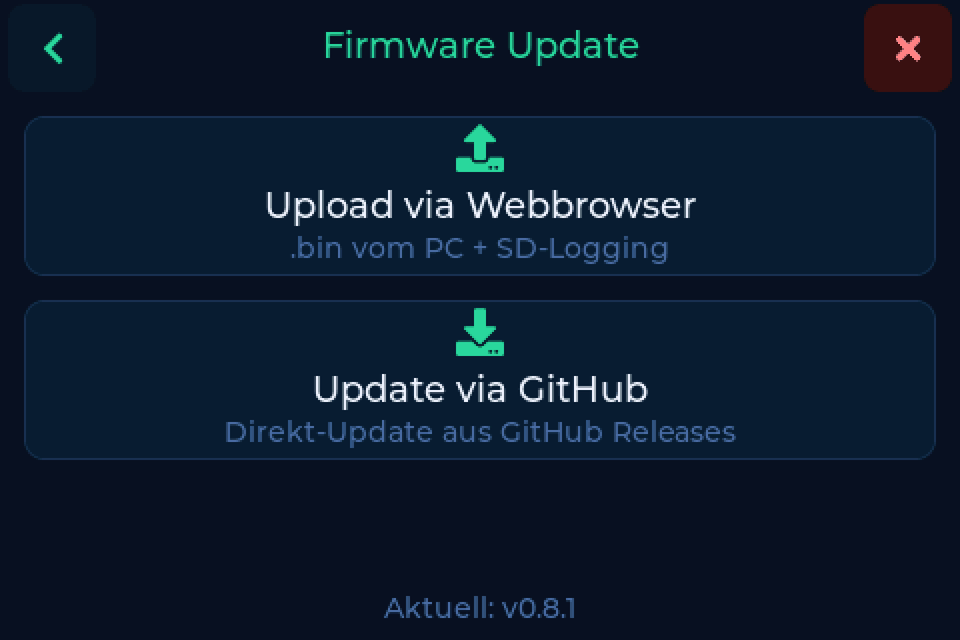
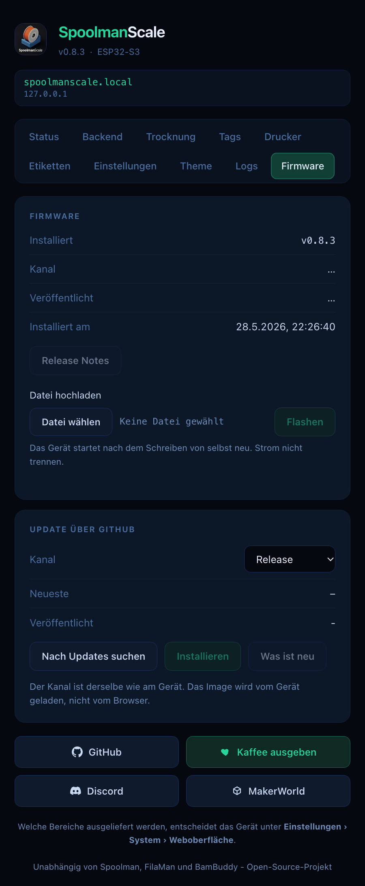

# Firmware aktualisieren

Nach dem [ersten Flash](index.md#der-erste-flash-der-web-flasher) laufen Updates
am Gerät oder aus dem Browser, ohne USB-Kabel.

!!! note "Noch auf der alten Speicheraufteilung? Ein Update per USB"
    0.8 teilt den Speicher der Waage neu auf (6 MB statt 3 MB für die
    Firmware), und das geht nur über das Kabel, einmal. 0.8.3 passt nicht mehr in
    die alte Aufteilung: Eine Waage, die den Schritt ausgelassen hat, installiert
    es nicht über WLAN und zeigt stattdessen einen QR-Code zum Web-Flasher. Öffne den
    [Web-Flasher](https://niko11111.github.io/SpoolmanScale/) in Chrome oder
    Edge, schließ die Waage an und wähle **Update**. Das dauert etwa 2 Minuten,
    WLAN, Kalibrierung und Backend-Einstellungen bleiben erhalten. Bietet der
    Flasher stattdessen "Install" an, lass "Erase" ohne Haken, sonst sind WLAN
    und Kalibrierung weg.

    

??? tip "Wenn der Flasher meldet: Failed to initialize"
    Er kommt nicht an den Chip heran. Probier nacheinander:

    1. Alles schließen, was den USB-Port belegen könnte: Arduino IDE, Slicer,
       ein zweiter Tab mit dem Flasher.
    2. Ein anderes Kabel, sicher ein Datenkabel, an einer USB-Buchse direkt am
       Rechner, ohne Hub.
    3. Die Waage von Hand in den Download-Modus bringen. Die Display-Platine
       hat auf der Rückseite nur einen Taster, **RST**. **BOOT** (GPIO0) liegt
       am 7-poligen **DEBUG**-Stecker daneben, und das optionale Debug-Board
       (ZXACC-ESPDB), das dort aufgesteckt wird, hat beide Taster.

        **Mit Debug-Board:** **BOOT** gedrückt halten, **RST** kurz drücken,
        **BOOT** loslassen.

        **Ohne:** Pin 6 (BOOT) und Pin 7 (GND) des DEBUG-Steckers mit einem
        kurzen Draht verbinden, **RST** drücken, Draht abziehen. Pin 1 am
        anderen Ende führt 5V, deshalb GND vorher mit dem Multimeter suchen:
        Er piept gegen das Metallgehäuse der USB-C-Buchse.

        Das Display bleibt dunkel, das ist richtig: Der Chip wartet jetzt auf
        den Flasher. Im Flasher verbinden und installieren, danach einmal
        **RST** drücken.

---

## Am Gerät

**Einstellungen → System → Firmware Update**

1. **Auf Updates prüfen** antippen
2. Die Waage fragt bei GitHub nach und zeigt dir die Release Notes zu dem, was
   sie gefunden hat
3. **Installieren** antippen

Sie lädt, schreibt und startet von selbst neu und meldet dabei, wie weit sie ist.

---

## Aus dem Browser

Die Firmware-Seite der [Weboberfläche](web.md) tut dasselbe mit mehr Platz zum
Lesen und funktioniert auch vom Handy.

{ width="420" }

!!! note "Braucht Wartung"
    Die Firmware-Seite liegt hinter dem Schalter **Wartung**, und der ist
    standardmäßig aus. Einschalten unter **Einstellungen → System →
    Weboberfläche**. Siehe [Die Weboberfläche](web.md#die-drei-schalter).

---

## Eine bestimmte Version installieren

Wenn ein Update scheitert oder du auf eine bestimmte Version zurück willst:

1. Die `.bin` von den
   [GitHub Releases](https://github.com/Niko11111/SpoolmanScale/releases) laden
2. Die Firmware-Seite der [Weboberfläche](web.md) öffnen
3. Die Datei hochladen

---

## Release oder Vorabversion

Veröffentlichungen gibt es in zwei Sorten:

| Sorte | Sieht aus wie | Für |
|---|---|---|
| Release | `v0.8.3` | alle |
| Vorabversion | `v0.8.4-beta.1` | Testen und Rückmelden im Discord |

Die vollständige Historie steht auf der
[Releases-Seite](https://github.com/Niko11111/SpoolmanScale/releases) - jede
Version bringt ihre eigenen Notizen mit.

!!! tip "Tester willkommen"
    Drei Backends, vier Tag-Formate und jede Menge Hardware-Kombinationen sind
    mehr, als eine Werkbank abdecken kann. Wenn auf einer Vorabversion etwas klemmt, sag
    Bescheid, im [Discord](https://discord.gg/K3KmKnrWhP) oder als Issue. Genau
    dafür ist sie da.
