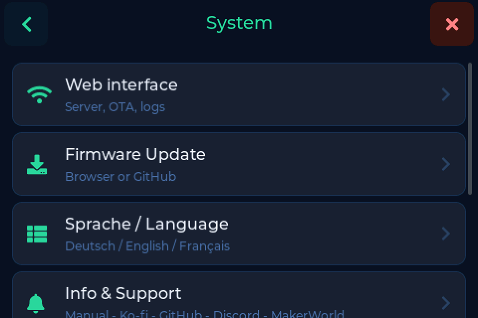
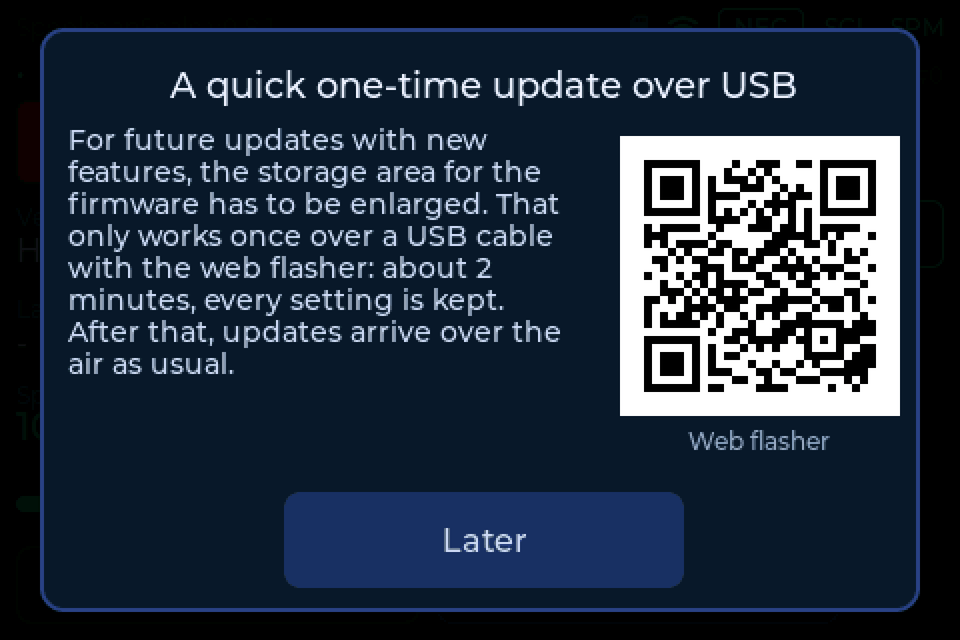
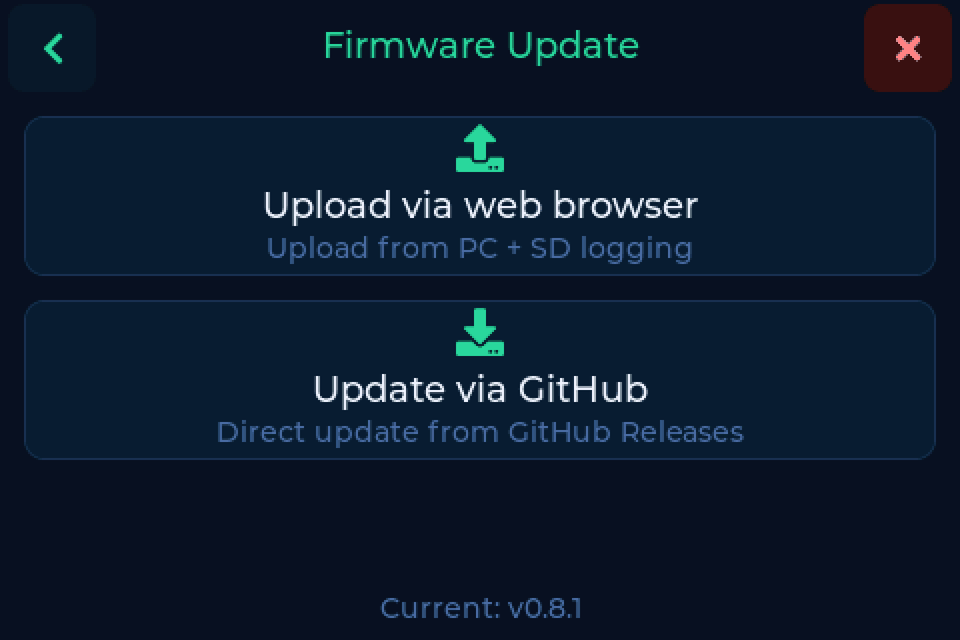
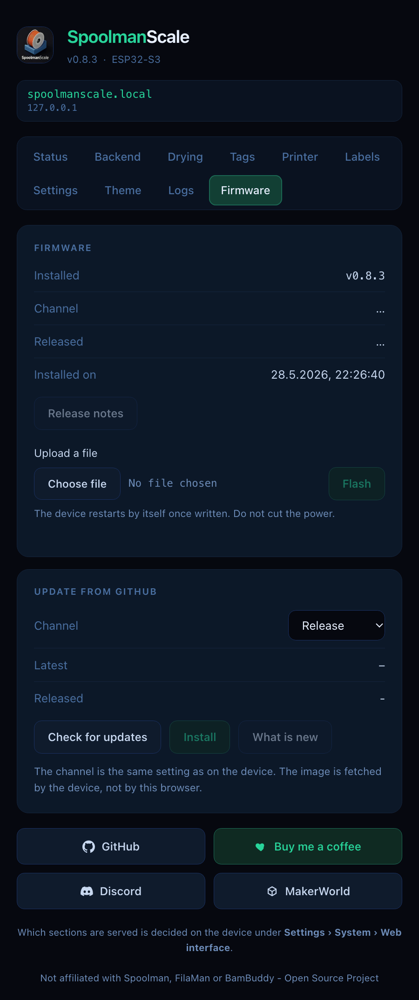

# Updating the firmware

After the [first flash](index.md#first-flash-the-web-flasher) updates run on the
device or from your browser, without the USB cable.

!!! note "Still on the old memory layout? One update over USB"
    0.8 divides the scale's memory anew (6 MB instead of 3 MB for the
    firmware), and that can only be done over the cable, once. 0.8.3 no longer
    fits the old layout, so a scale that skipped this step does not install it
    over the air and shows a QR code to the web flasher instead. Open the
    [web flasher](https://niko11111.github.io/SpoolmanScale/) in Chrome or Edge,
    connect the scale and choose **Update**. It takes about 2 minutes, and WiFi,
    calibration and backend settings are kept. If the flasher offers "Install"
    instead, leave "Erase" unticked, or WiFi and calibration are gone.

    

??? tip "If the flasher says: Failed to initialize"
    It cannot reach the chip. Try these in order:

    1. Close everything that may hold the USB port: Arduino IDE, a slicer,
       a second tab with the flasher.
    2. Use a different cable, one that carries data, in a USB port straight on
       the computer, no hub.
    3. Put the scale into download mode by hand. The display board has only
       a **RST** button on its back. **BOOT** (GPIO0) is on the 7-pin
       **DEBUG** connector next to it, and the optional debug board
       (ZXACC-ESPDB) plugged in there has both buttons.

        **With the debug board:** hold **BOOT**, press and release **RST**,
        release **BOOT**.

        **Without it:** bridge pin 6 (BOOT) and pin 7 (GND) of the DEBUG
        connector with a short wire, press **RST**, remove the wire. Pin 1 at
        the other end carries 5V, so find GND with a multimeter first: it
        beeps against the metal shell of the USB-C socket.

        The screen stays dark, that is right: the chip now waits for the
        flasher. Connect in the flasher and install, then press **RST** once.

---

## From the device

**Settings → System → Firmware Update**

1. Tap **Check for updates**
2. The scale asks GitHub, and shows you the release notes for what it found
3. Tap **Install**

It downloads, writes and reboots on its own, reporting how far it got as it
goes.

---

## From the browser

The firmware page of the [web interface](web.md) does the same thing with more
room to read, and works from a phone.

{ width="420" }

!!! note "Needs Maintenance"
    The firmware page sits behind the **Maintenance** switch, which is off by
    default. Turn it on under **Settings → System → Web interface**. See
    [The web interface](web.md#the-three-switches).

---

## Installing a specific version

If an update fails, or you want to go back to a particular release:

1. Download the `.bin` from
   [GitHub Releases](https://github.com/Niko11111/SpoolmanScale/releases)
2. Open the firmware page in the [web interface](web.md)
3. Upload the file

---

## Release or pre-release

Releases come in two kinds:

| Kind | Looks like | For |
|---|---|---|
| Release | `v0.8.3` | everyone |
| Pre-release | `v0.8.4-beta.1` | testing, reporting back on Discord |

The full history is on the
[releases page](https://github.com/Niko11111/SpoolmanScale/releases) - every
version carries its own notes.

!!! tip "Testers welcome"
    Three backends, four tag formats and a lot of hardware combinations are more
    than one workbench can cover. If something goes wrong on a pre-release, say so on
    [Discord](https://discord.gg/K3KmKnrWhP) or open an issue. That is what it
    is for.
